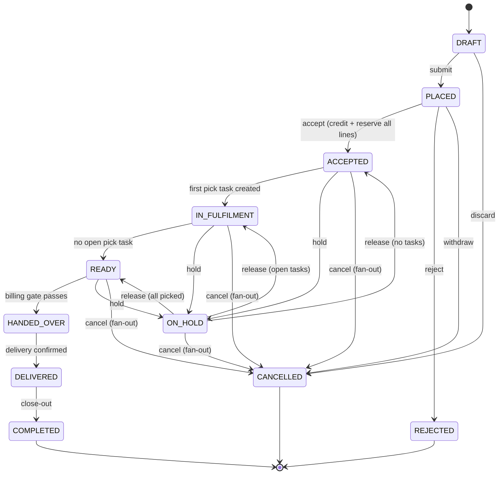
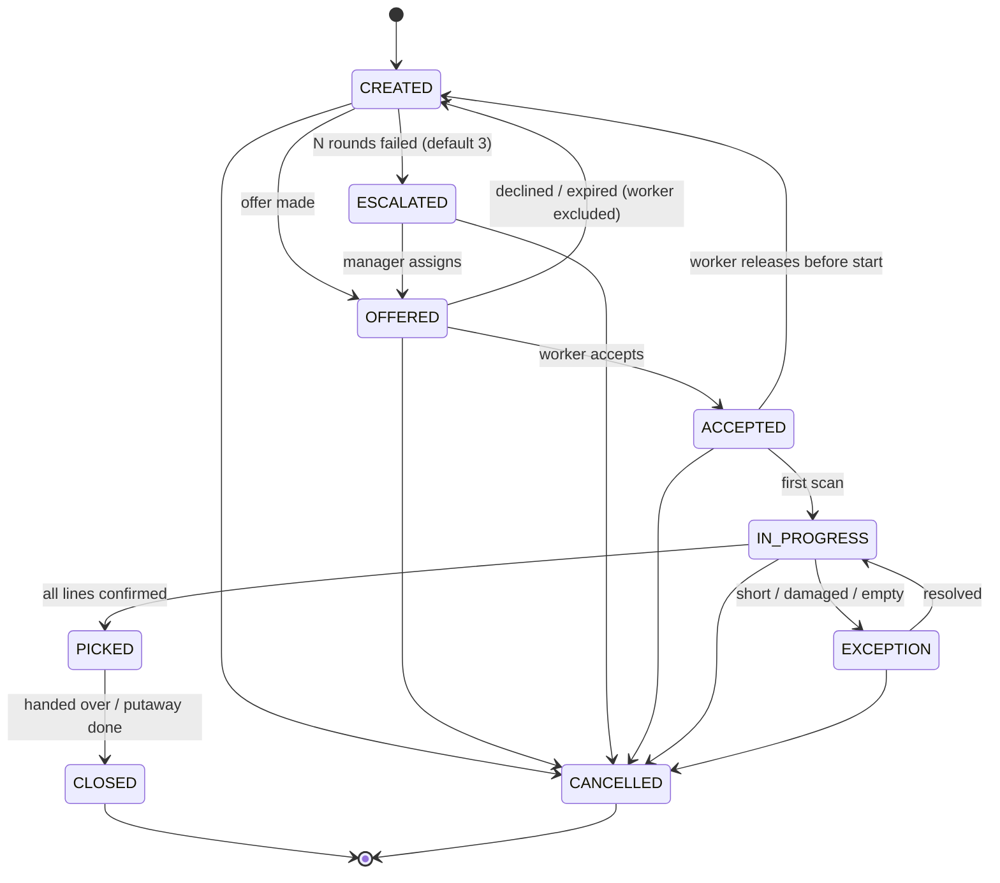

# ADR-0025 — Order and task state: a short order status, and every other lifecycle on its own record

**Status:** Accepted — signed off by the platform owner alongside ADR-0024, 2026-09-28 (PR #76) ·
**Date:** 2026-09-28 · **Plan:** [fulfilment/plan.md](../fulfilment/plan.md)

The fulfilment build adds orders, pick tasks and worker offers to `operations`. It puts them in
`app/orders/` and `app/fulfilment/`, with the tables listed in the plan's §2. Each of these records
has a lifecycle, and so do the invoice and payment an order leads to. This ADR decides where each of
those statuses lives, how transitions are declared and refused, and how two actors racing on the
same record are serialised. The status vocabulary becomes customer data once the first order
exists. Filters, reports, webhook payloads and saved views all name these values, so it has to be
settled before F2's migration.

Builds on [ADR-0000](0000-phase-0-decisions.md) §7 (the event envelope's `correlation_id` /
`causation_id`, which is what makes a cancellation fan-out traceable), §9's related immutability
rules (append-only history; corrections are new rows) and §10 (no cross-schema foreign keys);
[ADR-0014](0014-inventory-and-manufacturing.md) §3 (the stock kernel and its idempotency), §6
(documents follow `*_TRANSITIONS` maps in `domain.py`) and §11 (release through the kernel). It also
follows [io-outside-transactions.md](../io-outside-transactions.md) (no network call inside an open
transaction).

## 1. The order keeps a short commercial status; task, offer, invoice and payment status live on their own records

**Why now.** It is tempting to have one `orders.status` enum walk the whole lifecycle:
`PICK_OFFERED`, `PICK_DECLINED`, `PICKING`, `PARTIALLY_PICKED`, `INVOICED`, `PAID`,
`PARTIALLY_REFUNDED` and so on, 30+ values. That breaks on the first real order:

- **A two-zone order has two pick tasks, and they are in different states at once.** One is
  `PICKED` while the other worker is still walking to the zone. A single field has to either lie
  (show one task's state) or invent a combination (`PARTIALLY_PICKED`). Each new pair of concurrent
  lifecycles multiplies the combinations again.
- **A worker declining an offer says nothing about the order.** The order is exactly as committed
  to the customer as before; one person said no to one task. If the order's field moved on a
  decline, "what state is this order in" would depend on warehouse staffing noise.
- **Invoice and payment already have owners.** Finance owns invoices and credit notes, and
  `payment` owns charges and refunds (the plan's reuse table). Mirroring their states into
  `orders.status` makes a second, lagging copy of another service's truth.

With one field the answer to "what state is this order in" is ambiguous by construction. With
separate records every question has one place to look.

**Decision.** `orders.status` answers exactly one question: where the order stands commercially,
between the business and its customer. Everything else lives on its own row:

| Lifecycle | Lives on | Owner |
|---|---|---|
| Commercial status | `orders.status` | `operations` (`app/orders/`) |
| Picking | `pick_tasks.status`, one row per task (usually one per zone) | `operations` (`app/fulfilment/`) |
| Who was asked to do a task | `assignment_offers.state`, one row per offer (§3) | `operations` (`app/fulfilment/`) |
| Invoice | finance's own tables; the order stores the invoice id as a plain UUID, recorded from finance's event | `finance` |
| Payment / refund | payment's own tables; the order stores the reference as a plain UUID | `payment` |

The order may also carry **facts** that the other lifecycles report back, such as an invoice id or
a `paid_at` timestamp. These are timestamps and references, written by the event consumer that
learned them. They are never extra status values.

### Order status vocabulary

`DRAFT, PLACED, ACCEPTED, IN_FULFILMENT, ON_HOLD, READY, HANDED_OVER, DELIVERED, COMPLETED,
CANCELLED, REJECTED`. `COMPLETED`, `CANCELLED` and `REJECTED` are terminal.

### Order transitions

This is the content of `ORDER_TRANSITIONS` in `app/orders/domain.py`. Any move not listed,
including a no-op move to the same status, answers 409. That is the same rule `can_transition_po`
documents.

| From | To | Trigger |
|---|---|---|
| `DRAFT` | `PLACED` | Operator or channel submits the order. Lines are valid and priced. Nothing is reserved yet. |
| `DRAFT` | `CANCELLED` | Draft discarded. There is nothing to compensate. |
| `PLACED` | `ACCEPTED` | Operator accepts, or auto-accept runs. **Guarded, see below.** |
| `PLACED` | `REJECTED` | The business declines the order (reason required). Nothing was reserved. A payment captured at placing is refunded, as in the cancellation fan-out. |
| `PLACED` | `CANCELLED` | Customer or operator withdraws before acceptance. |
| `ACCEPTED` | `IN_FULFILMENT` | The order's first pick task is created. |
| `ACCEPTED` | `ON_HOLD` | Operator hold (reason required). |
| `ACCEPTED` | `CANCELLED` | Cancellation fan-out. |
| `IN_FULFILMENT` | `READY` | No pick task on the order is in an open state (`CREATED`, `OFFERED`, `ESCALATED`, `ACCEPTED`, `IN_PROGRESS`, `EXCEPTION`), and at least one is `PICKED`. |
| `IN_FULFILMENT` | `ON_HOLD` | Operator hold. |
| `IN_FULFILMENT` | `CANCELLED` | Cancellation fan-out. |
| `ON_HOLD` | `ACCEPTED` / `IN_FULFILMENT` / `READY` | Hold released. The target is **recomputed from facts**, not remembered: no tasks yet → `ACCEPTED`; open tasks → `IN_FULFILMENT`; all tasks picked → `READY`. |
| `ON_HOLD` | `CANCELLED` | Cancellation fan-out. |
| `READY` | `HANDED_OVER` | Goods leave the business's hands. **Guarded by the billing gate, see below.** |
| `READY` | `ON_HOLD` | Operator hold, e.g. the customer asks to delay collection. |
| `READY` | `CANCELLED` | Cancellation fan-out. |
| `HANDED_OVER` | `DELIVERED` | Delivery confirmed. For walk-in and counter handover, the handover *is* delivery: both transition rows are written in one transaction, so there is only one path. |
| `DELIVERED` | `COMPLETED` | Close-out. No task on the order is open, and every invoice the org's timing policy requires exists. |

A hold stops **new** offers on the order's tasks. It does not recall a worker already mid-aisle.
If those tasks finish while the order is held, the order stays `ON_HOLD`, and on release the
recomputation above sends it to `READY`. That is why the release target is derived from facts
rather than from whatever status the order had when it was held.

**Every order write** takes `SELECT … FOR UPDATE` on the order row and checks the caller's
`version` (a stale version is a 409). The transition, the `order_transitions` row (§4), the version
bump, the audit row and the outbox row are all written in that one transaction. Task writes that
can move the order take the **order row lock first, then the task row**, in that fixed order.
Example: two workers finish the two zones of one order at the same moment. Both confirmations
serialise on the order row, so the second one sees the first task already `PICKED`. It is the
second confirmation that moves the order to `READY`, and neither misses the other.

### Guard: `PLACED → ACCEPTED`

Acceptance is where the business commits stock, so it is where stock is reserved:

1. **Credit first, outside the lock.** For a credit-terms order, the customer's credit position is
   fetched from `finance` **before** the transaction opens. A network call never runs under a row
   lock (io-outside-transactions.md). If outstanding exposure plus this order's total exceeds the
   limit, the accept is refused with the numbers (limit, outstanding, this order), not with a bare
   "no". Cash and prepaid orders skip this step.
2. **Then one short transaction:** `SELECT … FOR UPDATE` on the order row. It checks `status =
   'PLACED'` and `version = :expected`, so two operators pressing Accept together serialise: the
   second waits, then sees `ACCEPTED` at a newer version and gets a 409.
3. **Every line is reserved in one kernel call, all-or-nothing,** with the idempotency key
   **`order:{id}:accept:v{version}`**. If any line is short, the whole accept is refused with
   `InsufficientStock` in the shape ADR-0014 §11 defines, including the reservations blocking it.
   No order is ever accepted with half its lines promised. The `version` check and the key do
   different jobs. The check refuses a *different*, stale write. The key makes a *retry of the
   same* accept, whose first attempt committed but whose response was lost, replay the original
   reservations instead of answering 409.

**Kernel prerequisite.** `app.inventory.ledger.reserve` takes one bucket per call today. It stores
its `idempotency_key` on the single `inventory_reservations` row that call creates, which is
unique per org (`uq_inventory_reservations_org_idempotency_key`). "Every line in one kernel call"
therefore needs a new multi-line entry point in `ledger.py`. That entry point:

- locks every bucket in the same deterministic order `post_move` uses (so two multi-line accepts
  cannot deadlock);
- checks every line under those locks before writing any of them;
- derives each line's reservation key as `order:{id}:accept:v{version}:{line_id}`.

It extends the kernel, not a second copy of it. ADR-0014 §3's "`post_move` is the only writer"
rule has the same intent for reservations.

The credit position read in step 1 can change between the read and the commit. For example, two
credit-terms orders for one customer may be accepted at the same moment, each passing on its own.
That window is accepted: it is bounded by one order's value, and the alternative would be either a
network call under a lock or a local copy of finance's receivables.

### Guard: `READY → HANDED_OVER`, the billing gate

Handover is the last point where the business still holds the goods, so it is where money
conditions are enforced. The gate reads **only the order's own columns**: facts recorded from
finance's and payment's events. It never calls another service on the handover path. All three
conditions must hold:

- **Invoice exists, if policy says it should by now.** The org's invoice-timing policy (in
  `fulfilment_settings`, e.g. invoice at acceptance, or before dispatch) says whether an invoice
  must exist at handover. If it must, the order's invoice reference must be set.
- **Paid, if the payment terms require payment before dispatch.** Prepaid and cash-on-counter
  orders need a recorded capture. Credit-terms orders do not.
- **Pickup code verified, if the org requires one.** The code the customer presents matches the
  one issued for the order, and the match is recorded on the order in this same transaction.

A failed gate is a 409 that names **which** condition failed. The trade-off of reading local facts
is eventual consistency: a payment captured a moment ago may not have reached the order through
the event yet, and the gate refuses until it does. That is the right direction to be wrong in.
Letting goods leave on a payment that has not been confirmed is not.

### Cancellation: refused after handover, and a fan-out before it

Any move to `CANCELLED` from `HANDED_OVER`, `DELIVERED` or `COMPLETED` is refused. Once goods have
left, getting them back is a **return**, a different flow with its own document. It is not a
cancellation. Nothing on an order moves backwards silently (ADR-0014 §6).

From any earlier status, cancelling is one operations transaction followed by compensating actions
in the services that own the records:

| Exists at cancel time | Who acts | How |
|---|---|---|
| Open reservations | `operations`, same transaction | Released through `ledger.release`, the kernel path ADR-0014 §11 established. |
| Stock already picked (a task `PICKED`, or `IN_PROGRESS` with a picked quantity) | `operations`, same transaction | A **putaway task** is created. Stock moves back through `post_move` when the putaway is done, not at cancel time: the goods are physically in staging until someone carries them back. |
| Open pick tasks and live offers | `operations`, same transaction | Tasks → `CANCELLED`; live offers → `WITHDRAWN` (§3). |
| An issued invoice | `finance`, after commit | Finance consumes the order-cancelled event and issues its **own credit note**. Invoices are frozen; the correction is a new document (ADR-0000 §9). |
| A captured payment | `payment`, after commit | Payment consumes the same event and issues the refund. `refunds` is append-only there already. |

Operations **does not write finance's or payment's tables**. The event carries the invoice and
payment references the order holds. It goes out through the outbox after commit, with the
envelope's `correlation_id` / `causation_id` (ADR-0000 §7), so "was the credit note ever issued
for this cancellation" can be traced hop by hop. Consumers are idempotent through the existing
`ProcessedEvent` ledger. The order does not wait for these actions and does not un-cancel if one of
them fails. A failed refund is payment's to retry and surface. Once a compensation lands, its
completion is recorded on the order as a fact (e.g. a credit note id), not as a new order status,
following the rule at the top of this section.

**Rejected:**

- **One lifecycle enum on the order.** It is ambiguous for any order with more than one task, as
  argued above.
- **An order status per task (`orders.status` derived as the "minimum" task state).** This hides
  the commercial state (a held order whose tasks are all picked is still held) and turns every
  task write into an order-status rewrite.
- **Reserving at `PLACED`.** This would promise stock for orders the business has not agreed to
  fill. An order that sits unaccepted for a day blocks stock that another, accepted order needs.



## 2. The pick task is its own state machine

**Decision.** `pick_tasks.status` has its own vocabulary and its own `PICK_TASK_TRANSITIONS` map in
`app/fulfilment/domain.py`:

`CREATED, OFFERED, ESCALATED, ACCEPTED, IN_PROGRESS, EXCEPTION, PICKED, CLOSED, CANCELLED`.
`CLOSED` and `CANCELLED` are terminal.

| From | To | Trigger |
|---|---|---|
| `CREATED` | `OFFERED` | An offer is made (§3): chosen by the assignment engine, or assigned manually. |
| `CREATED` | `ESCALATED` | The task has used up its automatic rounds: *N* offers declined or expired, where *N* is `fulfilment_settings` per org, default **3**. |
| `ESCALATED` | `OFFERED` | A manager assigns a worker by hand. |
| `OFFERED` | `CREATED` | The offer is declined or expires. The worker is excluded from every later automatic round of this task (a manager may still pick them by hand). The round counter advances. |
| `OFFERED` | `ACCEPTED` | The worker accepts (the conditional update in §3). |
| `ACCEPTED` | `CREATED` | The worker releases the task before starting. Treated as a failed round, same exclusion. |
| `ACCEPTED` | `IN_PROGRESS` | First scan on the task. |
| `IN_PROGRESS` | `EXCEPTION` | Short pick, damage, location empty (a `pick_exceptions` row). |
| `EXCEPTION` | `IN_PROGRESS` | Exception resolved, picking continues. |
| `IN_PROGRESS` | `PICKED` | Every line confirmed through `post_move`. |
| `PICKED` | `CLOSED` | The order is handed over, or, on a cancelled order, the putaway that reverses it is done. |
| `CREATED`, `OFFERED`, `ESCALATED`, `ACCEPTED`, `IN_PROGRESS`, `EXCEPTION` | `CANCELLED` | The order is cancelled, or a manager cancels the task. Anything already picked goes to putaway (§1). |

A `PICKED` task is **not** cancellable. Its work happened. If the order is cancelled, the pick
closes and a putaway task reverses it, which is ADR-0014 §6's "a reversal is its own transition".

**An escalated task sits in a manager queue for manual assignment. Manual assignment is just
another path into `OFFERED`, not a different state.** The manager's choice creates an ordinary
`assignment_offers` row, and the worker accepts or declines it like any other offer. There is no
`MANUALLY_ASSIGNED` status and no second accept path to test. If that worker declines, the task
returns to `CREATED`, finds its rounds already used, and goes straight back to `ESCALATED`. Until
auto-assignment ships (the plan defers it past F3), every offer is a manual one and the round
counter still runs, so escalation behaves the same on the day the engine arrives.

A supervisor's `operations.fulfilment.task.override` (dangerous, per the plan) is a stronger
permission on edges **that are in the map**. It is not a way around the map. An override that needs
an edge that does not exist needs this ADR amended first.



## 3. The offer is its own row, not a field on the task

**Why now.** One task can be offered to several workers across rounds. A manager will ask "why did
this order take forty minutes to start?", and the answer is a history: A was asked at 10:02 and let
it expire, B declined at 10:07, C was chosen at 10:11 because the other two scored lower on
distance. A `current_worker_id` column on the task keeps only the last line of that story.

**Decision.**

```
assignment_offers(organization_id, id, task_id, worker_id, round, state,
                  score_breakdown JSONB, offered_at, expires_at, responded_at)
```

- `state`: `OFFERED, ACCEPTED, DECLINED, EXPIRED, WITHDRAWN, RELEASED`. `WITHDRAWN` is used when the
  task is cancelled under a live offer. `RELEASED` is used when the worker hands back an accepted
  task before starting (§2), which frees the task for the next round.
- `score_breakdown` records **why this worker was chosen**: each factor's value and weight at the
  moment of the offer. For a manual assignment it records who assigned it. It is kept so that a
  manager can read it **later**, when asking why the order was slow, and not only when the offer is
  made. The engine's scoring will change over time. The breakdown is what the engine believed at
  the time.
- `task_id` and `worker_id` are same-schema foreign keys. Every index leads with `organization_id`,
  per the house rule `AuditLogMixin` documents.

**Concurrency, stated precisely.**

- **At most one live offer per task.** A partial unique index on `assignment_offers
  (organization_id, task_id) WHERE state IN ('OFFERED', 'ACCEPTED')`. The database refuses a second
  simultaneous live offer, whichever code path tries to make it. `organization_id` leads the index
  per the house rule. Because `task_id` is a UUID, uniqueness is the same as on `task_id` alone.
- **Accept is one conditional update, not read-then-write:**

  ```sql
  UPDATE assignment_offers
     SET state = 'ACCEPTED', responded_at = now()
   WHERE id = :offer AND worker_id = :me AND state = 'OFFERED' AND expires_at > now()
  ```

  **A zero-row update is a 409, not a 500.** The offer expired, was withdrawn, was already answered,
  or is not the caller's. The task's `OFFERED → ACCEPTED` is a second conditional update (`WHERE id
  = :task AND status = 'OFFERED'`) in the same transaction. The expiry sweep, scheduled through
  `services/scheduler` per the plan, is also a conditional update: `SET state = 'EXPIRED' WHERE id =
  :offer AND state = 'OFFERED'`. Accept and expiry therefore race on one row, and whichever lands
  first wins. Both compare against the database's `now()`, never an application clock. An accept
  that arrives after the expiry has fired changes nothing, which is the plan's F3 exit criterion.
- **This is the pattern ADR-0014 §3 already uses** for `post_move`'s idempotency. There, the move
  header is inserted with `ON CONFLICT DO NOTHING` and "no row came back" means "someone else got
  here first, replay theirs". Here, the offer is updated with a guarding `WHERE` and "no row
  changed" means "the offer is no longer yours to take". In both cases the database settles the race
  in one statement. The difference: §3's statement is a conditional insert, this one is a
  conditional update.

**Rejected:** `pick_tasks.assigned_worker_id` plus an `offer_expires_at` column. It is simpler for
exactly one round and loses every earlier round, which is the part a manager asks about.

## 4. Every order and task transition is an append-only row

**Decision.** Each order transition inserts a row into `order_transitions` (`order_id,
from_status, to_status, actor, reason, at`) in the same transaction as the status change. The table
joins `APPEND_ONLY_TABLES` in `services/operations/migrations/env.py`, which is how the stock
ledger's append-only rule survives grant re-application today. Pick-task and offer state changes
are captured by the existing `AuditLog` (`AuditLogMixin`, written by `record_audit` in the same
transaction) plus the outbox row the change emits. History is never rewritten in place. A reopened
or reversed record is a new transition, never an edited old one.

**This is not a new idea.** ADR-0000 §9 already makes invoices, the credit ledger and usage events
append-only, and ADR-0014 §3 does the same for the stock ledger. This is the same rule applied to a
new document type. The only choice here is that orders get a dedicated transitions table while
tasks use the audit log. Order history is shown to customers and operators and queried by status
and time. Task history is an operational trail, and the audit log already carries it.

## 5. Transitions are declared as data in `domain.py`, enforced by the write path, never by a CHECK constraint

**Decision.** `orders.status` and `pick_tasks.status` are `String(20)` columns with **no CHECK
constraint**. The vocabulary lives in `ORDER_TRANSITIONS` and `PICK_TASK_TRANSITIONS`
(`dict[str, frozenset[str]]`, pure, no I/O). Every write path calls a `can_transition_*` helper and
raises `ConflictProblem` on a miss before touching the row.

The precedent is the `PurchaseOrder.status` column in `services/operations/app/models.py`, whose
comment reads:

> draft | approved | received | closed | cancelled. `String(20)`, no CHECK — the vocabulary lives
> in `app.domain.PO_TRANSITIONS`, enforced by the write path, not the column.

`approve_purchase_order`, `receive_purchase_order`, `close_purchase_order` and
`cancel_purchase_order` in `services/operations/app/services.py` each check
`domain.can_transition_po(...)` and raise `ConflictProblem` on a miss. This ADR applies an
existing, proven house pattern. It does not invent one. A CHECK on the column would say which
values exist but not which *moves* are legal, and adding a status would need a migration as well as
a map edit. The map is the one place that answers both questions, and it is testable without a
database.

The orders go one step further than the PO path does today: the transition check runs **under
the order row lock** (§1). The PO write path reads the row and checks it without `FOR UPDATE`.
Orders have many more concurrent writers (operators, workers, event consumers) than a PO does.

## Consequences

- **Order status and task status cannot later be merged into one enum** without breaking the
  two-tasks-per-order case in §1. The first two-zone order would need a combined state that does
  not exist.
- **The offer table's history is what makes a manager's "why did this take so long" question
  answerable.** It cannot later be summarised away (collapsed to the last offer, or rows pruned
  after acceptance) without losing that answer. Retention of `assignment_offers` follows order
  retention, not a shorter operational window.
- **The stock kernel grows a multi-line, all-or-nothing reserve** before F2 can meet the
  `PLACED → ACCEPTED` guard (§1). It is kernel work under ADR-0014's rules, not order-module code.
- **The billing gate is eventually consistent by design.** Handover can briefly refuse after a
  payment is taken, until the event lands. The 409 names the missing fact so the counter screen
  can say "waiting for payment confirmation" rather than fail silently.
- **Cancellation is complete in operations immediately and in finance/payment eventually.** A
  cancelled order with a pending credit note or refund is visible as an unset fact on the order,
  not as an order status.
- **Revisit if** the platform takes returns (a new document with its own ADR, not new edges out of
  `HANDED_OVER`), or if a single order routinely needs partial handover of some lines ahead of
  others. That would make handover a per-shipment state (the plan's `shipments`), not an order
  state.
