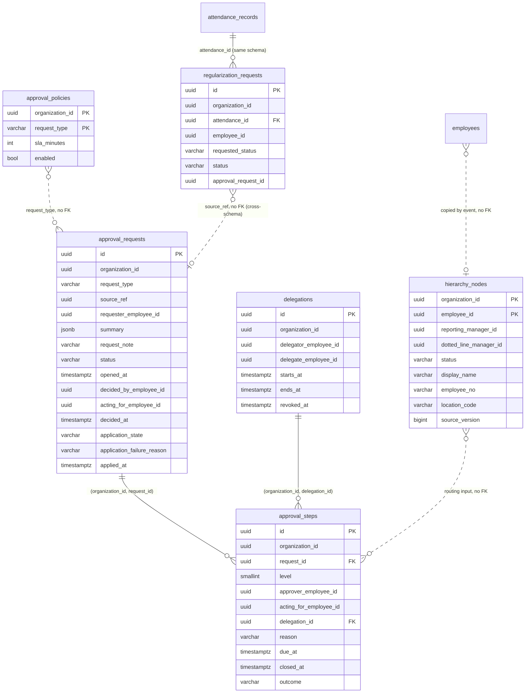

# Approval engine — persistence design

Companion to [ADR-0006](adr/0006-approval-engine.md). This document is the schema contract for
three services: the new `approval` schema, one additive change to `employee`, and one new table in
`attendance`. It specifies tables, constraints, indexes, roles and migration order. **Update 2026-10-15: the `approval` service, its models and its migrations now exist (`services/approval/`); the code wins where it differs from this design. Originally: no migration
or model code was written** — this was the design the migrations had to implement.

**Aligned 2026-09-16 with the amended ADR-0006** (its §14 lists the consequential edits it expects
here) and with the new [ADR-0007](adr/0007-permission-rollout-to-live-tenants.md). Everything the
amendment changed — the hierarchy copy's columns, the SLA floor, the `summary`/`request_note` split,
the write-once application trio and the extended guard trigger, the sweep's new batch shape, and the
two endpoints that landed on this schema — was re-verified against the running database rather than
transcribed. Where a statement in the ADR is not implementable as written, this document says so and
gives the implementable form; those are called out inline and listed at the end of §3.3 and §7.

Every plan and behaviour claim below was executed against the dev PostgreSQL 16.4 (`localhost:5434`)
inside a transaction that was rolled back: a scratch schema, seeded to volume (300k–1M requests,
375k–1.25M steps, 300 organizations with a skewed size distribution), with row-level security
enabled and the queries run as `opsgrids_app` (NOBYPASSRLS) and `opsgrids_outbox` (BYPASSRLS). The
numbers are cold-cache on a laptop container; treat them as ratios, not SLOs.

One exception to the rolled-back rule: the liveness-probe measurements in §2.2. An index-only scan
needs the visibility map, only `VACUUM` sets it, and `VACUUM` cannot run inside a transaction — so
that run used a **committed** scratch schema (375,003 steps, `VACUUM ANALYZE`d), dropped afterwards
and verified gone. Its `Heap Fetches: 0` lines are real rather than an artefact of an unvacuumed
table.

Conventions inherited and not restated per table: `TIMESTAMPTZ` in UTC everywhere; UUID keys;
`organization_id NOT NULL` on every table and leading every index; no cross-schema foreign keys;
`created_at`/`updated_at`/`created_by`/`updated_by` from the platform mixins; no floating point
(no money appears in this slice at all).

---

## 1. Schema `approval`

### 1.0 Mixin deviations, stated once

- `OrgScopedMixin` declares `organization_id` with `index=True`, which emits a single-column
  `ix_approval_<table>_organization_id`. **Every table here overrides it to `index=False`**, because
  each one already has a composite index or constraint leading with `organization_id`. A duplicate
  leading-column index costs write throughput on the highest-write table in the service and serves
  no query. This is a deliberate departure from the copy-paste shape of the older services.
- `hierarchy_nodes` and `approval_policies` use a **natural composite primary key**, so they compose
  `OrgScopedMixin` + `TimestampMixin` rather than `TenantBase` (no surrogate `id`).
- `SoftDeleteMixin` (`deleted_at`) is carried only where `TenantBase` is used, and is **never
  written**. The guard triggers treat it as immutable. Nothing in this domain is soft-deleted:
  requests and steps are history, delegations are revoked.

### 1.0.1 Constraint and index naming — declare it the way the convention will produce it

`libs/platform-core/src/platform_core/models.py` fixes the convention for the whole estate:

```python
NAMING_CONVENTION = {
    "ix": "ix_%(column_0_label)s",
    "uq": "uq_%(table_name)s_%(column_0_name)s",
    "ck": "ck_%(table_name)s_%(constraint_name)s",
    "fk": "fk_%(table_name)s_%(column_0_name)s_%(referred_table_name)s",
    "pk": "pk_%(table_name)s",
}
```

`make migration-check` (`alembic check` per service, CI gate `.github/workflows/ci.yml`) compares the
name in the model against the name in the database, so a name the migration wrote and a name
SQLAlchemy generates must agree exactly. The rules below were verified by building these tables
against SQLAlchemy 2.0.52 with this convention and printing what came out — not inferred from the
format strings.

1. **PRIMARY KEY — leave unnamed.** Produces `pk_<table>`. Every `pk_…` in this document is that.
2. **CHECK — declare a bare suffix.** `CheckConstraint("status in (…)", name="status")` on
   `approval_requests` produces `ck_approval_requests_status`. Two observed failure modes: an
   *unnamed* `CheckConstraint` raises `InvalidRequestError: Naming convention including
   %(constraint_name)s token requires that constraint is explicitly named` at import; and a name
   that already carries the prefix is prefixed **again** —
   `name="ck_approval_requests_status"` produced
   `ck_approval_requests_ck_approval_requests_status`. **Every `ck_…` name printed in this document
   is the produced name; what you declare is everything after `ck_<table>_`.** This matches
   `services/billing` and `services/subscription`, which declare `name="state"`, `name="currency_iso"`.
3. **UNIQUE — always declare explicitly.** The convention keys on the *first column only*, so the
   two composite uniques on `approval_requests`, both leading with `organization_id`, are **both**
   auto-named `uq_approval_requests_organization_id` — verified, SQLAlchemy emitted that identical
   name twice, and Postgres cannot create the second. The `uq` template has no `%(constraint_name)s`
   token, so an explicit name is used verbatim.
4. **FOREIGN KEY — declare explicitly, and name it after the *pointer* column, not the tenant
   column.** Unnamed, `%(column_0_name)s` is the constraint's first column, which on every composite
   FK in this design is `organization_id`: `FOREIGN KEY (organization_id, dotted_line_manager_id)`
   auto-names `fk_employees_organization_id_employees`, and a future second tenant-leading self-FK
   (`reporting_manager_id`) would collide with it.
5. **Index — declare explicitly.** Unnamed, `%(column_0_label)s` is schema-qualified and names only
   the leading column: `Index(None, "organization_id", "request_id")` on `approval.approval_steps`
   produced `ix_approval_approval_steps_organization_id`, which collides with every other unnamed
   org-leading index — and with the one `OrgScopedMixin` would emit (§1.0).
6. **EXCLUDE — always name it.** The convention has **no key for `ExcludeConstraint`** at all;
   verified that an unnamed one keeps `name=None`, leaving Postgres to invent a name that no model
   will ever match.

One correction to the review that raised this: an explicit name that is *not* convention-shaped does
not fail the gate. `alembic check` passes today on `account`, which carries `uq_org_units_org_code`
and `uq_memberships_user_org` (verified by running it: "No new upgrade operations detected").
What breaks the gate is an **unnamed** object whose generated name the migration did not use, a
**duplicate** generated name, and the `ck` doubling in rule 2.

7. **Check the length.** Postgres truncates identifiers at 63 bytes and a truncated name matches
   nothing, so a long generated name fails the gate silently. The longest name in this design is
   `fk_regularization_requests_attendance_id_attendance_records`, at 59.

### 1.1 `hierarchy_nodes` — the read-only copy of the reporting lines

| Column | Type | Null | Default | Notes |
|---|---|---|---|---|
| `organization_id` | uuid | no | — | PK part 1 |
| `employee_id` | uuid | no | — | PK part 2. `employee.employees.id`, plain UUID |
| `reporting_manager_id` | uuid | yes | — | Plain UUID. **Not a foreign key even within this schema** |
| `dotted_line_manager_id` | uuid | yes | — | Stored, never routed (ADR-0006 §2) |
| `status` | varchar(20) | no | — | `probation\|active\|on_notice\|exited` |
| `display_name` | varchar(200) | no | — | `employees.full_name`. **Not** a sealed field (ADR-0006 §2) |
| `employee_no` | varchar(40) | no | — | `employees.employee_no`. Rendered beside the name to disambiguate |
| `location_code` | varchar(40) | yes | — | `account.locations.code`. Kept: the SPA resolves it to a timezone |
| `source_version` | bigint | no | — | The employee row's `hierarchy_version` this state came from |
| `source_occurred_at` | timestamptz | no | — | Display and debugging only. **Never compared** |
| `created_at`, `updated_at` | timestamptz | no | `now()` | |

```
CONSTRAINT pk_hierarchy_nodes PRIMARY KEY (organization_id, employee_id)
CHECK (status IN ('probation','active','on_notice','exited'))      ck_hierarchy_nodes_status
CHECK (source_version >= 0)                                        ck_hierarchy_nodes_source_version_non_negative
CHECK (reporting_manager_id IS NULL OR reporting_manager_id <> employee_id)    ck_hierarchy_nodes_manager_not_self
CHECK (dotted_line_manager_id IS NULL OR dotted_line_manager_id <> employee_id) ck_hierarchy_nodes_dotted_not_self
CHECK (length(btrim(display_name)) > 0)                            ck_hierarchy_nodes_display_name_present
CHECK (length(btrim(employee_no)) > 0)                             ck_hierarchy_nodes_employee_no_present
```

**Which columns the copy carries, and why** (ADR-0006 §2, amended). `display_name` and
`employee_no` are here because approval stores people as UUIDs and an ordinary approver holds
`hrms.people.employee.read:OWN` — they can resolve nobody but themselves, so without a local name
every approval screen renders raw ids. Both are fed by the same full-state events, so they cost one
field each on an event that is already being changed. `display_name` is `employees.full_name`, which
is deliberately outside employee's PII envelope (that covers date of birth, personal contact, PAN,
Aadhaar, UAN, ESI and bank details), so copying it moves no ciphertext and needs no unmask
permission. `location_code` is kept because it now has a named consumer: it is a *code*, resolved by
the SPA against `GET /api/v1/locations` to render every instant in the requester's timezone.
`department_id` is **dropped** — it had no consumer, and rendering it would have required a second
denormalised name fed by a third service's events.

Both new columns are `NOT NULL`, which is safe precisely because of the version gate below: an event
from an un-upgraded employee pod carries no `hierarchy_version` and is ignored wholesale, so no
half-populated row can be written. Every row that exists came from full state.

**No `UNIQUE (organization_id, employee_no)` on the copy**, even though the source enforces exactly
that (`uq_employees_org_employee_no`). The copy is eventually consistent and events for two
employees arrive independently: if a number is ever reassigned between two people, the two upserts
can transiently collide, and a unique constraint would reject the second and dead-letter it. This is
the same argument as the missing foreign key on `reporting_manager_id` — the copy must accept any
state the source can pass through, because it sees those states one row at a time.

**Why `reporting_manager_id` has no foreign key even though the target is in the same schema.**
Events arrive in any order. A report's `onboarded` can be consumed before their manager's, so a
foreign key would reject a legitimate row and dead-letter it. The manager pointer is allowed to
dangle; the chain walk simply ends when it cannot find the next node, which ADR-0006 §4 already
routes to an unassigned step.

**Ordering rule.** Apply an event or backfill row only when its version is strictly greater:

```sql
INSERT INTO approval.hierarchy_nodes AS h (organization_id, employee_id, reporting_manager_id,
       dotted_line_manager_id, status, display_name, employee_no, location_code,
       source_version, source_occurred_at)
VALUES (...)
ON CONFLICT (organization_id, employee_id) DO UPDATE
   SET reporting_manager_id   = EXCLUDED.reporting_manager_id,
       dotted_line_manager_id = EXCLUDED.dotted_line_manager_id,
       status                 = EXCLUDED.status,
       display_name           = EXCLUDED.display_name,
       employee_no            = EXCLUDED.employee_no,
       location_code          = EXCLUDED.location_code,
       source_version         = EXCLUDED.source_version,
       source_occurred_at     = EXCLUDED.source_occurred_at,
       updated_at             = now()
 WHERE h.source_version < EXCLUDED.source_version;
```

Verified: the plan shows `Conflict Resolution: UPDATE` with `Conflict Filter: (h.source_version <
excluded.source_version)`; a replayed or reordered event updates zero rows and the consumer treats
that as success (it must not raise — a dropped stale event is the desired outcome).

> **Naming note.** ADR-0006 §2 names this column `source_version`; the hand-off brief called it
> `hierarchy_version`. This document follows the ADR, and reserves `hierarchy_version` for the
> *employee* column that feeds it. They hold the same value, and the asymmetry is deliberate: on
> `employees` it is the row's own version, on the copy it is the version of the source it came from.

### 1.2 `approval_policies` — SLA only

| Column | Type | Null | Default | Notes |
|---|---|---|---|---|
| `organization_id` | uuid | no | — | PK part 1 |
| `request_type` | varchar(120) | no | — | PK part 2 |
| `sla_minutes` | integer | no | `1440` | |
| `enabled` | boolean | no | `true` | `false` disables **escalation only** |
| `created_at`, `updated_at`, `created_by`, `updated_by` | | | | |

```
CONSTRAINT pk_approval_policies PRIMARY KEY (organization_id, request_type)
CHECK (sla_minutes BETWEEN 15 AND 525600)           ck_approval_policies_sla_minutes_range
CHECK (request_type ~ '^[a-z][a-z0-9_]*\.[a-z][a-z0-9_]*\.[a-z][a-z0-9_]*$')  ck_approval_policies_request_type_shape
```

**The floor of 15 minutes is a constraint, not an API rule** (ADR-0006 §8, §10). A tenant that could
set `sla_minutes = 1` would manufacture overdue steps faster than any tick could drain them; the
per-organization sweep cap then merely slows that tenant down, while the floor makes the
pathological case unconfigurable in the first place. It is enforced here rather than in the API so
that no path — a `PUT`, a fixture, a future bulk import, a `psql` session — can write below it.
Verified: `14` and `1` are rejected with `23514`, `15` and the `1440` default are accepted, and the
`525600` ceiling is unchanged.

A missing row means the defaults (`enabled = true`, `sla_minutes = 1440`); the row is created on
first `PUT`. **No seeding per organization is required or wanted** — a provisioning hook that writes
a policy row per organization per request type is a second source of truth for a default that
already lives in code.

**`request_type` is validated by shape, not by an enumerated list.** This is the one place this
design deliberately departs from "a CHECK constraint for every enum". ADR-0006's stated consequence
is that a second request type "adds no table, no endpoint and no routing code"; an `IN (...)` list
would make every new request type a migration on two tables, one of which is the largest table in
the service. The vocabulary is closed *in code* (the per-type mapping in `consumers.py`), and the
database enforces the `<product>.<module>.<thing>` grammar from ADR-0006 §12. Verified: `'Regularization'`
is rejected with `23514`.

### 1.3 `approval_requests` — the routing aggregate

| Column | Type | Null | Default | Notes |
|---|---|---|---|---|
| `id` | uuid | no | `uuid4` | PK |
| `organization_id` | uuid | no | — | |
| `request_type` | varchar(120) | no | — | |
| `source_ref` | uuid | no | — | The product row's id (regularisation request id) |
| `requester_employee_id` | uuid | no | — | The product's statement of whose request it is |
| `summary` | jsonb | no | — | **Structured facts only** — dates and closed vocabularies, no free text |
| `request_note` | varchar(500) | yes | — | The requester's free text. Classified customer content (below) |
| `status` | varchar(20) | no | `'pending'` | `pending\|approved\|rejected` |
| `opened_at` | timestamptz | no | — | Approval's own clock, not the producer's |
| `decided_by_employee_id` | uuid | yes | — | NOT NULL once decided, by CHECK |
| `acting_for_employee_id` | uuid | yes | — | Set only when eligibility came via a delegated step |
| `decided_at` | timestamptz | yes | — | |
| `comment` | text | yes | — | The decider's comment. Optional for **both** outcomes (ADR-0006 §7) |
| `application_state` | varchar(20) | yes | — | `applied\|failed`. NULL until the product reports back |
| `application_failure_reason` | varchar(500) | yes | — | Set **iff** `failed` |
| `applied_at` | timestamptz | yes | — | When the product reported, on the database clock |
| timestamps + `deleted_at` | | | | from `TenantBase` |

```
CONSTRAINT uq_approval_requests_org_type_source UNIQUE (organization_id, request_type, source_ref)
CONSTRAINT uq_approval_requests_org_id          UNIQUE (organization_id, id)
CHECK ((status = 'pending') = (decided_at IS NULL)
   AND (status = 'pending') = (decided_by_employee_id IS NULL))   ck_approval_requests_decided_iff_not_pending
CHECK (acting_for_employee_id IS NULL OR decided_by_employee_id IS NOT NULL) ck_approval_requests_acting_for_needs_decider
CHECK (decided_by_employee_id IS NULL OR decided_by_employee_id <> requester_employee_id) ck_approval_requests_decider_not_requester
CHECK (decided_at IS NULL OR decided_at >= opened_at)             ck_approval_requests_decided_after_open
CHECK (status IN ('pending','approved','rejected'))               ck_approval_requests_status
CHECK (jsonb_typeof(summary) = 'object')                          ck_approval_requests_summary_is_object
CHECK (NOT jsonb_exists(summary, 'reason'))                       ck_approval_requests_summary_no_free_text
CHECK (request_note IS NULL OR length(btrim(request_note)) > 0)   ck_approval_requests_request_note_present
CHECK (request_type ~ '...')                                      ck_approval_requests_request_type_shape
CHECK (application_state IN ('applied','failed'))                 ck_approval_requests_application_state
CHECK ((application_state IS NULL) = (applied_at IS NULL))        ck_approval_requests_applied_at_iff_application_state
CHECK ((application_failure_reason IS NOT NULL)
        = (coalesce(application_state,'') = 'failed'))            ck_approval_requests_application_failure_reason_iff_failed
CHECK (application_state IS NULL OR status <> 'pending')          ck_approval_requests_application_needs_decision
CHECK (applied_at IS NULL OR applied_at >= decided_at)            ck_approval_requests_applied_after_decided
```

**`summary` and `request_note`: the snapshot, split by classification** (ADR-0006 §3, amended).
The earlier rule — `summary` carries the requester's `reason` and "must never contain PII" — was a
promise, not a constraint. The split makes it structural:

- **`summary`** holds only structured, enumerable facts from the requesting event: for
  regularisation `date`, `from`, `to`. Every value is a date or a member of a closed vocabulary, so
  "no free text" is true by construction rather than by discipline.
  `ck_approval_requests_summary_no_free_text` is the cheap guard against the one regression that is
  actually likely — copying `reason` back into the JSONB, which is exactly where it used to live.
  Verified: a summary carrying a `reason` key is rejected with `23514`.
- **`request_note`** holds the requester's free text (regularisation's `reason`, ≤500 characters).

**Its classification: customer content authored by the requester about their own working day.** It
is *not* a PII field and is deliberately **not sealed**. Sealing it would protect nothing — the same
text is already stored in plaintext in `attendance.regularization_requests.reason` (§5) — while
costing a great deal: `platform_core.pii` writes one audit row per unmask, and this text is read by
every approver on every inbox render, which would mean an audit row per page view drowning the trail
that PII auditing exists to make readable. A control that must be bypassed to render a list is not a
control.

**Who may read it, and the four rules that are actually enforceable:**

1. It never appears in a **published event payload** — not `opened`, `escalated` or `decided`.
   Events cross services and land in a broker.
2. It never appears in an **audit `before`/`after` blob** or a log line, the same rule employee
   applies to sealed fields, which record field *names* only.
3. It is returned **only** to a principal who is the requester, is currently eligible (ADR-0006 §6),
   or holds `read:ORG` — never on an unauthenticated or cross-tenant surface.
4. The cross-tenant discovery session **cannot read it at all**, by grant rather than by convention
   (§3.3). This is the only one of the four the database itself enforces; rules 1–3 are review rules,
   and they are stated as such rather than dressed up as guarantees.

**The application trio is write-once and cannot precede a decision.** `ck_…_application_needs_decision`
makes "applied while pending" unrepresentable, `ck_…_applied_at_iff_application_state` keeps the
timestamp and the state together, and `ck_…_application_failure_reason_iff_failed` is written over
`coalesce(application_state,'')` deliberately: the natural form
`(failure_reason IS NOT NULL) = (application_state = 'failed')` evaluates to NULL — and therefore
*passes* — when `application_state` is NULL, which would let a failure reason be attached to a
request that never reported. Verified on the insert path: `applied_at` with no state, a state on a
pending row, a failure reason with no state, and `applied_at` earlier than `decided_at` are all
rejected with `23514`; a decided-and-applied row is accepted. On the *update* path the guard trigger
(§1.4) refuses most of these one layer earlier with `23001` — both layers exist, and the CHECKs are
what hold for an `INSERT`, which no trigger guards.

`ck_approval_requests_decided_iff_not_pending` is the coordinator's delta 4 in its strongest form:
a decided request **cannot** exist without a decider, and a pending one cannot carry one.
`ck_approval_requests_decider_not_requester` makes "the requester is never eligible" a database fact
rather than only a service check — the single rule in ADR-0006 §6 that overrides every other route
to eligibility, including `decide:ORG`. Both verified (`23514`).

**Both uniques are declared explicitly, and must be** (§1.0.1 rule 3). They both lead with
`organization_id`, so left to the convention both would be named `uq_approval_requests_organization_id`
and the table would not create.

`uq_approval_requests_org_id` exists to be the target of the composite foreign key from
`approval_steps`. It is an integrity index, not a query index, and it is worth its write cost:
without it, a step row can name a request in another tenant and no constraint objects.

### 1.4 `approval_steps` — append-only routing history

| Column | Type | Null | Default | Notes |
|---|---|---|---|---|
| `id` | uuid | no | `uuid4` | PK |
| `organization_id` | uuid | no | — | |
| `request_id` | uuid | no | — | |
| `level` | smallint | no | — | 1..33 (32 rungs + the unassigned terminus) |
| `approver_employee_id` | uuid | yes | — | NULL = unassigned |
| `acting_for_employee_id` | uuid | yes | — | The represented original approver |
| `delegation_id` | uuid | yes | — | The delegation that produced this step |
| `reason` | varchar(20) | no | — | `assigned\|delegated\|escalated\|unassigned` |
| `opened_at` | timestamptz | no | — | |
| `due_at` | timestamptz | yes | — | NULL = never escalates |
| `closed_at` | timestamptz | yes | — | Set exactly when the step leaves `open` |
| `outcome` | varchar(20) | no | `'open'` | `open\|delegated\|escalated\|approved\|rejected` |
| timestamps + `deleted_at` | | | | from `TenantBase` |

```
FOREIGN KEY (organization_id, request_id)    REFERENCES approval_requests (organization_id, id)
                                                   fk_approval_steps_request_id_approval_requests
FOREIGN KEY (organization_id, delegation_id) REFERENCES delegations       (organization_id, id)
                                                   fk_approval_steps_delegation_id_delegations
CHECK (level BETWEEN 1 AND 33)                                            ck_approval_steps_level_range
CHECK (outcome IN ('open','delegated','escalated','approved','rejected')) ck_approval_steps_outcome
CHECK (reason  IN ('assigned','delegated','escalated','unassigned'))      ck_approval_steps_reason
CHECK ((approver_employee_id IS NULL) = (reason = 'unassigned'))          ck_approval_steps_unassigned_iff_no_approver
CHECK (approver_employee_id IS NOT NULL OR due_at IS NULL)                ck_approval_steps_unassigned_has_no_due
CHECK ((reason = 'delegated') = (delegation_id IS NOT NULL))              ck_approval_steps_delegated_iff_delegation
CHECK ((delegation_id IS NULL) = (acting_for_employee_id IS NULL))        ck_approval_steps_acting_for_iff_delegation
CHECK (acting_for_employee_id IS NULL OR acting_for_employee_id <> approver_employee_id) ck_approval_steps_acting_for_not_approver
CHECK ((outcome = 'open') = (closed_at IS NULL))                          ck_approval_steps_closed_iff_not_open
CHECK (closed_at IS NULL OR closed_at >= opened_at)                       ck_approval_steps_closed_after_open
CHECK (approver_employee_id IS NOT NULL OR outcome IN ('open','approved','rejected')) ck_approval_steps_unassigned_outcomes
```

Both foreign keys are named after the **pointer** column rather than `organization_id`, which is
their actual first column — see §1.0.1 rule 4. Left unnamed they would be
`fk_approval_steps_organization_id_approval_requests` and
`fk_approval_steps_organization_id_delegations`: legal, distinct, and useless to read.

Four of these encode rules that would otherwise live only in `services.py`:

- an unassigned step has no approver, **no due date and never escalates** — the last CHECK makes
  `outcome = 'escalated'` on an unassigned step unrepresentable, so ADR-0006 §8's "the ladder
  terminates by construction" is true in the database, not just in the sweep;
- `due_at IS NULL` with an approver present is **legal**, and that is what `enabled = false`
  produces (ADR-0006 §10). This is why the constraint is an implication rather than the tighter
  `(approver IS NULL) = (due_at IS NULL)` — verified with a passing insert;
- `delegated` reason, `delegation_id` and `acting_for_employee_id` stand or fall together, so a
  delegated step whose delegation cannot be checked for revocation cannot exist (ADR-0006 §5 makes
  eligibility depend on that delegation still being active);
- the composite FK on `(organization_id, delegation_id)` makes a **cross-tenant delegation reference
  unrepresentable**. Verified: `23503`.

#### Invariant: a pending request has exactly one open step

```sql
CREATE UNIQUE INDEX uq_approval_steps_open_per_request
    ON approval.approval_steps (organization_id, request_id) WHERE outcome = 'open';
```

This is the concurrency control for the whole service. Two sweep replicas escalating the same step,
or an escalation racing a delegation re-point, cannot both insert a successor: the second gets
`23505`. Verified. It also serves the decision path's "give me the open step" lookup directly
(0.07 ms).

#### Append-only enforcement

`REVOKE` alone does not hold: `migrations/env.py` runs `apply_schema_grants` after **every**
migration run, which re-grants `UPDATE`/`DELETE` on all tables and only re-revokes `audit_logs`.
This is the trap the metering append-only migration documents. So, exactly as
`subscription_transitions` does it, the durable enforcement is a trigger, with the revoke as a
second layer applied in this service's `env.py`:

```sql
CREATE OR REPLACE FUNCTION approval.guard_approval_step_change() RETURNS trigger LANGUAGE plpgsql AS $$
BEGIN
  IF TG_OP = 'DELETE' THEN
    RAISE EXCEPTION 'approval_steps is append-only; step % cannot be deleted', OLD.id
      USING ERRCODE = 'restrict_violation';
  END IF;
  IF OLD.outcome <> 'open' THEN
    RAISE EXCEPTION 'approval step % is % and immutable', OLD.id, OLD.outcome
      USING ERRCODE = 'restrict_violation';
  END IF;
  IF NEW.outcome = 'open'
     OR (NEW.id, NEW.organization_id, NEW.request_id, NEW.level, NEW.approver_employee_id,
         NEW.acting_for_employee_id, NEW.delegation_id, NEW.reason, NEW.opened_at, NEW.due_at,
         NEW.created_at, NEW.created_by, NEW.deleted_at)
        IS DISTINCT FROM
        (OLD.id, OLD.organization_id, OLD.request_id, OLD.level, OLD.approver_employee_id,
         OLD.acting_for_employee_id, OLD.delegation_id, OLD.reason, OLD.opened_at, OLD.due_at,
         OLD.created_at, OLD.created_by, OLD.deleted_at)
  THEN
    RAISE EXCEPTION 'approval step %: the only permitted change is closing an open step (outcome, closed_at)',
      OLD.id USING ERRCODE = 'restrict_violation';
  END IF;
  RETURN NEW;
END $$;

CREATE TRIGGER trg_approval_steps_append_only
    BEFORE UPDATE OR DELETE ON approval.approval_steps
    FOR EACH ROW EXECUTE FUNCTION approval.guard_approval_step_change();
```

`updated_at` and `updated_by` are intentionally absent from the comparison list, because the ORM
bumps them on any flush. Everything else is frozen. Verified behaviour: closing an open step
succeeds; closing it while also moving `due_at` fails; re-pointing an approver in place fails;
touching an already-terminal step fails; `DELETE` fails.

**Two sibling guards, same shape** (both verified):

- `trg_delegations_revoke_only` on `delegations` — refuses `DELETE`, allows only
  `revoked_at`/`revoked_by_employee_id` to be set, once. An extend-the-window update and an un-revoke
  both fail.
- `trg_approval_requests_decide_once` on `approval_requests` — refuses `DELETE`, freezes
  identity/`summary`/`request_note`/`opened_at` while pending, and **permits exactly one change to a
  decided request: the write-once application trio** (ADR-0006 §12). It is no longer "refuse any
  update to a non-pending request", because the product must be able to report back that the
  decision did or did not land — but the decision itself stays frozen.

```sql
CREATE OR REPLACE FUNCTION approval.guard_approval_request_change() RETURNS trigger LANGUAGE plpgsql AS $$
BEGIN
  IF TG_OP = 'DELETE' THEN
    RAISE EXCEPTION 'approval_requests is not deletable; request %', OLD.id
      USING ERRCODE = 'restrict_violation';
  END IF;

  IF OLD.status = 'pending' THEN
    IF (NEW.id, NEW.organization_id, NEW.request_type, NEW.source_ref, NEW.requester_employee_id,
        NEW.summary, NEW.request_note, NEW.opened_at, NEW.created_at, NEW.created_by, NEW.deleted_at)
       IS DISTINCT FROM
       (OLD.id, OLD.organization_id, OLD.request_type, OLD.source_ref, OLD.requester_employee_id,
        OLD.summary, OLD.request_note, OLD.opened_at, OLD.created_at, OLD.created_by, OLD.deleted_at)
    THEN
      RAISE EXCEPTION 'approval request %: identity, summary, request_note and opened_at are frozen', OLD.id
        USING ERRCODE = 'restrict_violation';
    END IF;
    IF NEW.application_state IS NOT NULL THEN
      RAISE EXCEPTION 'approval request %: application cannot be reported before a decision', OLD.id
        USING ERRCODE = 'restrict_violation';
    END IF;
    RETURN NEW;
  END IF;

  -- OLD is decided: the only permitted change is the write-once application trio.
  IF OLD.application_state IS NOT NULL THEN
    RAISE EXCEPTION 'approval request %: application already reported as %', OLD.id, OLD.application_state
      USING ERRCODE = 'restrict_violation';
  END IF;
  IF NEW.application_state IS NULL THEN
    RAISE EXCEPTION 'approval request % is decided and immutable', OLD.id
      USING ERRCODE = 'restrict_violation';
  END IF;
  IF (NEW.id, NEW.organization_id, NEW.request_type, NEW.source_ref, NEW.requester_employee_id,
      NEW.summary, NEW.request_note, NEW.status, NEW.opened_at, NEW.decided_by_employee_id,
      NEW.acting_for_employee_id, NEW.decided_at, NEW.comment,
      NEW.created_at, NEW.created_by, NEW.deleted_at)
     IS DISTINCT FROM
     (OLD.id, OLD.organization_id, OLD.request_type, OLD.source_ref, OLD.requester_employee_id,
      OLD.summary, OLD.request_note, OLD.status, OLD.opened_at, OLD.decided_by_employee_id,
      OLD.acting_for_employee_id, OLD.decided_at, OLD.comment,
      OLD.created_at, OLD.created_by, OLD.deleted_at)
  THEN
    RAISE EXCEPTION 'approval request %: only application_state, application_failure_reason and applied_at may be set after a decision', OLD.id
      USING ERRCODE = 'restrict_violation';
  END IF;
  RETURN NEW;
END $$;
```

As in the step guard, `updated_at`/`updated_by` are absent from both comparison lists because the ORM
bumps them on any flush. Verified behaviour (`23001` unless stated): reporting the application on a
*pending* request fails; deciding a pending request succeeds; setting the trio once on a decided
request succeeds; setting it a **second** time fails; setting the trio while also editing `comment`,
flipping `status`, re-pointing `decided_by_employee_id` or rewriting `request_note` all fail;
re-deciding a decided request fails; editing `request_note` while pending fails; `DELETE` fails.

The "first decision wins" property is unchanged — it is now enforced by the third branch rather than
by a blanket refusal, and the decision columns are listed explicitly in the frozen tuple, so a future
column added to this table is frozen only if somebody adds it to that list. That is the one
maintenance cost of the change and it is why the list is spelled out rather than computed.

### 1.5 `delegations`

| Column | Type | Null | Notes |
|---|---|---|---|
| `id` | uuid | no | PK |
| `organization_id` | uuid | no | |
| `delegator_employee_id` | uuid | no | |
| `delegate_employee_id` | uuid | no | |
| `starts_at`, `ends_at` | timestamptz | no | Half-open `[starts_at, ends_at)` |
| `created_by_employee_id` | uuid | no | The employee who created it (HR may create for others) |
| `revoked_at`, `revoked_by_employee_id` | timestamptz / uuid | yes | Set together, once |
| timestamps + `deleted_at` | | | |

```
CONSTRAINT uq_delegations_org_id UNIQUE (organization_id, id)      -- target of the step FK
CHECK (delegate_employee_id <> delegator_employee_id)              ck_delegations_not_self
CHECK (ends_at > starts_at)                                        ck_delegations_window_forward
CHECK ((revoked_at IS NULL) = (revoked_by_employee_id IS NULL))    ck_delegations_revoked_pair
CONSTRAINT ex_delegations_no_overlap EXCLUDE USING gist (
    organization_id       WITH =,
    delegator_employee_id WITH =,
    tstzrange(starts_at, ends_at, '[)') WITH &&
) WHERE (revoked_at IS NULL)
```

`ex_delegations_no_overlap` **must** carry that explicit name: the convention has no key for
`EXCLUDE` at all, so an unnamed one is named by Postgres and matches nothing in the model
(§1.0.1 rule 6). `uq_delegations_org_id` is explicit for the same reason as the pair on
`approval_requests`.

**`btree_gist` is available — this is a database constraint, not a service-layer check.**
`tools/dev-bootstrap/init-db.sql` already runs `CREATE EXTENSION IF NOT EXISTS btree_gist` (line 5,
with the comment "exclusion constraints on overlapping ranges"), and the dev cluster reports
`btree_gist 1.7` on PostgreSQL 16.4. No bootstrap change is needed, and **no advisory lock or
`SELECT ... FOR UPDATE` dance is needed in `services.py`** — the constraint is atomic under
concurrency, which a read-then-insert check is not.

Verified: an overlapping non-revoked row for the same delegator is rejected (`23P01`); the same
delegator id in another organization is accepted (the tenant column is part of the constraint);
a window that starts exactly when another ends is accepted (half-open `[)` is the right choice —
with `[]` a one-day delegation could not be followed by another starting that day); after revoking,
an overlapping row is accepted.

`ends_at` is `NOT NULL`: an open-ended delegation is a governance smell and, more practically, an
unbounded range makes every future delegation for that delegator a constraint violation until
someone revokes it.

### 1.6 Platform tables

`outbox`, `processed_events`, `audit_logs` from the platform mixins, unchanged. `outbox` and
`audit_logs` are tenant-policied; **`processed_events` is deliberately un-policied** — it has no
`organization_id`, and any policy on it makes every idempotency lookup return nothing, silently
reprocessing every redelivered event (ADR-0002 §5).

---

## 2. Access patterns and the indexes that serve them

This table is the contract between the schema and `selectors.py`. Read frequency is per approver or
per request; "verified" is the measured plan from the seeded scratch schema under RLS.

**Read the `Index` column as a status, not a suggestion, and note that it holds two different kinds
of row.** A row tagged **required** names an index this pattern has already been measured to need:
the number beside it is the *indexed* plan, and without the index the pattern does not meet it. A row
tagged **REJECTED** is the opposite claim — the index was built, measured, and deliberately not
shipped, with the reasoning in §2.3. The two are not interchangeable and **must not be reasoned about
by analogy**: "pattern N ships without an index" is a fact about pattern N's measurement, never a
precedent for another pattern. §2.4 records the review where that analogy was drawn and what it cost.

| # | Pattern | Filter / sort | Index | Verified |
|---|---|---|---|---|
| 1 | Inbox | pending requests where I am `approver` (delegation still active) or `acting_for` on any step | `ix_approval_steps_org_approver`, `ix_approval_steps_org_acting_for`, `ix_approval_requests_org_pending` | 14.7 ms hot / 0.56 ms normal |
| 2 | Unassigned queue (ORG) | `outcome='open' AND approver IS NULL`, by `opened_at` | `ix_approval_steps_unassigned_open` | 2.2 ms |
| 3 | SLA sweep discovery | `outcome='open' AND approver IS NOT NULL AND due_at <= now()`, by `due_at`, cross-tenant, **slice of 500** | `ix_approval_steps_sla_due` | index-only, **7 buffers, 0.11 ms/500 rows**, `Heap Fetches: 0` |
| 3b | Sweep per-org cap | the 500-row slice, `row_number()` per org, keep 20, act on 100 | (none — a window over rows already in hand) | 13 buffers, 2.9 ms |
| 4 | Request by source | `(organization_id, request_type, source_ref)` | `uq_approval_requests_org_type_source` | 3 buffers, 0.19 ms |
| 5 | My requests | `(organization_id, requester)`, by `opened_at DESC` | `ix_approval_requests_org_requester_opened` | 0.21 ms |
| 6 | ORG request list | `(organization_id)`, by `opened_at DESC` | `ix_approval_requests_org_opened` | 0.06 ms |
| 7 | Request detail | `(organization_id, request_id)`, by `opened_at` | `ix_approval_steps_org_request` | 0.09 ms |
| 8 | The open step | `(organization_id, request_id) WHERE outcome='open'` | `uq_approval_steps_open_per_request` | 0.07 ms |
| 9 | Delegation re-point | my open, undelegated steps | **REJECTED** — served by `uq_approval_steps_open_per_request`; no dedicated index (§2.3) | 47 ms @ 2,986 org pending |
| 10 | Active delegation | delegator + instant | `ex_delegations_no_overlap` (GiST) | 0.10–0.40 ms |
| 11a | **`GET /delegations` at OWN** | `(organization_id)` + delegator **or** delegate, `deleted_at IS NULL`, by `starts_at DESC` | **required** — `ix_delegations_org_delegator_starts` + `ix_delegations_org_delegate_starts`, planner `BitmapOr` | **8 buffers / 0.048 ms**, from 624 / 3.98 ms unindexed (§2.2b) |
| 11b | **`GET /delegations` at ORG** | `(organization_id)` + `deleted_at IS NULL` only, by `starts_at DESC` | **required** — `ix_delegations_org_starts` | page **5 buffers / 0.038 ms** from a **1,754-buffer Seq Scan of the whole fleet table**; `paginate()`'s count 566 buffers / 7.1 ms (§2.2b) |
| 12 | Chain walk | recursive, upward, carrying `display_name` | `pk_hierarchy_nodes` | 10 rungs, 1.9 ms, one index scan per rung |
| 13 | Hierarchy upsert | `ON CONFLICT` + version gate | `pk_hierarchy_nodes` | 1.0 ms |
| 14 | **Stuck-request alarm (primary)** | `outcome='open' AND due_at IS NULL AND approver IS NULL`, by `opened_at`, `LIMIT 1`, cross-tenant | `ix_approval_steps_stuck_open` | index-only, 3 buffers, 0.015 ms |
| 15 | Escalation-disabled backlog | `outcome='open' AND due_at IS NULL AND approver IS NOT NULL`, by `opened_at`, `LIMIT 1`, cross-tenant | `ix_approval_steps_stuck_open` | index-only, 3 buffers, 0.014 ms |
| 16 | **`GET /delegate-candidates`** | `(organization_id)`, non-exited, `display_name`/`employee_no` prefix, cap 20 | `ix_hierarchy_nodes_org_display_name`, `ix_hierarchy_nodes_org_employee_no` | 3.4 ms / 853 buffers at 50k nodes (37 ms unindexed); **0.16 ms when the prefix matches nothing** |
| 17 | **Inbox "abandoned" arm** (§6 c) | org's open steps whose approver's node is `exited`, by `opened_at DESC`; plus the caller-active bind (§2.1) | `uq_approval_steps_open_per_request` + `ix_hierarchy_nodes_org_exited` | as shipped (`EXISTS`): **1.97 ms / 1,473 buffers**, vs 4.16 ms / 1,921 without the index, at 20k nodes / 3,200 open |
| 18 | **Decided-but-never-applied alarm** (§12) | `status<>'pending' AND application_state IS NULL AND decided_at < now()-n`, cross-tenant | `ix_approval_requests_unapplied` | index-only, **1 buffer, 0.017 ms** (7.7 ms seq scan without it) |
| 19 | **`GET /requests` at TEAM** (§11) | requests LEFT JOIN requester's node, `h.reporting_manager_id = sref`, by `opened_at DESC` | `ix_hierarchy_nodes_org_manager` feeding `ix_approval_requests_org_requester_opened` | index-only both sides, **0.081 ms / 89 buffers** (2.87 ms / 550 unindexed) |
| 20 | **`GET /requests` at LOCATION** (§11) | same join, `h.location_code = ANY(:loc)`, by `opened_at DESC` | **REJECTED** — hash join, no dedicated index, measured and rejected (§2.3) | 11.3 ms / 945 buffers at 40% selectivity; the rejected index gives 8.4 ms / 540 |

### 2.1 The inbox is the pattern that decides the step indexes

Because `delegated` and `escalated` are terminal (coordinator delta 2), eligibility can no longer be
expressed as "steps that are still open". It is "steps of a *pending request*", and a step's own
columns cannot tell you that. Two query shapes were measured against an approver with **29,906
history steps** in an organization with 2,986 pending requests (1M-request seed):

| Shape | Plan | Time |
|---|---|---|
| Drive from requests, `EXISTS` over steps | nested loop, 29,906 index probes into `approval_requests` | **312.8 ms** |
| Drive from steps, hash join to pending requests | hash join, one pass over each side | **27.1 ms** |

The steps-first shape wins by an order of magnitude, and the reason is structural rather than
incidental: the pending set is bounded by throughput × decision latency (thousands), while an
approver's history grows without bound. `selectors.py` must therefore write the inbox as a
**`UNION` of the three eligibility routes joined to the pending set**, not as an `EXISTS` subquery,
and `ix_approval_requests_org_pending` (partial, `WHERE status = 'pending'`) is what makes the
pending side cheap. Splitting the delegation-active check into its own `UNION` branch keeps the
common branch (`delegation_id IS NULL`) free of the join entirely.

This is the one place where the obvious query is 10× slower than the right one, so it is worth a
comment in `selectors.py` pointing back here.

**Both ORG arms carry the caller-active test** (ADR-0006 §6 condition 4, amended at slice 2 review).
The unassigned arm and the abandoned-approver arm each additionally require that **the caller's own**
node is not `exited` — the test is on the decider, not on the route, so it applies to a `decide:ORG`
holder exactly as it applies to a chain-assigned approver. The predicate belongs in the query rather
than only in the decision path: otherwise an exited `decide:ORG` holder is *shown* a queue they will
be refused on, which is a 403 discovered by clicking, and the inbox is the surface that returns
`request_note` (§1.3 rule 3).

**It does not change any plan measured here.** The caller's own status is resolved once per request
and enters the statement as a **bind parameter**, not as a third join to `hierarchy_nodes` — so the
arms keep the shapes measured above, and an exited caller's inbox is an empty result rather than an
error. Resolve it once and reuse it; re-joining the copy per arm would add a lookup per branch to
answer a question about a single employee.

### 2.2 The two cross-tenant discovery indexes, and why neither leads with `organization_id`

Every other index here leads with the tenant column because the RLS qual is ANDed into every
tenant-bound query. These two are the exception, exactly as `ix_dunning_cycles_due` is in
subscription: their queries exist to discover *which* tenants have work, so there is no tenant to
bind while asking. Both run on the sweep's `opsgrids_outbox` session (§3.3), and both `INCLUDE`
exactly the columns their caller needs so the answer never touches the heap.

```sql
CREATE INDEX ix_approval_steps_sla_due
    ON approval.approval_steps (due_at)
    INCLUDE (organization_id, request_id, id)
    WHERE outcome = 'open' AND approver_employee_id IS NOT NULL AND due_at IS NOT NULL;

CREATE INDEX ix_approval_steps_stuck_open
    ON approval.approval_steps (opened_at)
    INCLUDE (organization_id, request_id, id, approver_employee_id)
    WHERE outcome = 'open' AND due_at IS NULL;
```

**The two predicates are exact complements over open steps, and that is the point.**
`ix_approval_steps_sla_due` holds the open steps that *will* escalate. `ix_approval_steps_stuck_open`
holds the open steps that *never* will: the unassigned ones (no approver, and therefore no `due_at`,
by `ck_approval_steps_unassigned_has_no_due`) and the assigned ones whose policy has
`enabled = false`. The fourth combination — open, no approver, but a due date — is unrepresentable
because of that same CHECK. Verified on the seeded scratch: **zero open steps are in neither index**.
That coverage claim is load-bearing and it depends on the CHECK; relax the CHECK and a step can
become invisible to both alarms.

This matters because the population `ix_approval_steps_sla_due` omits is precisely the population
that gets stuck. An overdue assigned step has a named human and an escalation ladder behind it. An
unassigned step has neither, and nothing in the service will ever move it. Alarming only on the
overdue queue — as this document previously proposed in §7 — is an alarm pointed away from the
failure.

**Measurement basis.** 375,003 steps over 300 organizations, skewed: 360,129 closed, 13,122
open + assigned + due, 888 open + assigned with no due date (`enabled = false`), 864 open +
unassigned. Committed scratch schema, `VACUUM ANALYZE`d, plans taken as `opsgrids_outbox`, warm
figures from the second run. Heap 62 MB; `ix_approval_steps_sla_due` 1000 kB;
`ix_approval_steps_stuck_open` 176 kB.

**Probe A — unassigned-backlog age. This is the primary stuck-request signal.**

```sql
SELECT s.organization_id, s.request_id, s.id, s.opened_at
  FROM approval.approval_steps s
 WHERE s.outcome = 'open' AND s.due_at IS NULL AND s.approver_employee_id IS NULL
 ORDER BY s.opened_at
 LIMIT 1;
```

Before, with only the org-leading queue index available:

```
Limit  (actual time=2.345..2.384 rows=1)  Buffers: shared hit=823
  ->  Sort  (Sort Key: opened_at, top-N heapsort)
        ->  Bitmap Heap Scan on approval_steps  (actual rows=864)  Heap Blocks: exact=814
              Recheck Cond: outcome = 'open' AND approver_employee_id IS NULL
              Filter: (due_at IS NULL)
              ->  Bitmap Index Scan on ix_approval_steps_unassigned_open  (rows=864)
Execution Time: 2.879 ms   (0.573 ms warm)
```

After:

```
Limit  (actual time=0.005..0.006 rows=1)  Buffers: shared hit=3
  ->  Index Only Scan using ix_approval_steps_stuck_open  (actual time=0.005..0.005 rows=1)
        Filter: (approver_employee_id IS NULL)
        Heap Fetches: 0
Execution Time: 0.015 ms   (0.292 ms cold)
```

823 buffers and a sort of the entire backlog become 3 buffers and no sort. The important property is
not the microseconds, it is that the cost no longer grows with the backlog — the old shape got more
expensive exactly when the alarm was most likely to fire.

**The 3-buffer figure is the slice-4 steady state, and slices 2–3 are not that state.** ADR-0006 §10
opens every step with `due_at = NULL` until slice 4, which means `ix_approval_steps_stuck_open` holds
*every open step in the service* rather than the small stuck population. Re-measured at 15,710 open
steps with no due date against 60 unassigned ones (the index grows to 2,136 kB): the planner
**abandons this index** and serves probe A from `ix_approval_steps_unassigned_open` instead, reading
its 60 entries and top-N sorting them — 31 buffers, 0.045 ms warm. That is still cheap, and it is
worth knowing why: the probe does not degrade, it changes plan, because the tenant-leading unassigned
index becomes the more selective of the two. Both plans are acceptable; neither claim should be
quoted without its population. The index sizing in this section (176 kB, 1000 kB) likewise describes
slice 4 onward.

**Probe B — oldest overdue assigned step. Secondary.** Unchanged query, restated with its plan:

```sql
SELECT s.organization_id, s.request_id, s.id, s.due_at
  FROM approval.approval_steps s
 WHERE s.outcome = 'open' AND s.approver_employee_id IS NOT NULL
   AND s.due_at IS NOT NULL AND s.due_at <= now()
 ORDER BY s.due_at
 LIMIT 1;
```

```
Limit  (actual time=0.006..0.007 rows=1)  Buffers: shared hit=3
  ->  Index Only Scan using ix_approval_steps_sla_due  (actual time=0.006..0.006 rows=1)
        Index Cond: (due_at <= now())
        Heap Fetches: 0
Execution Time: 0.015 ms   (0.171 ms cold)
```

**Probe C — escalation-disabled backlog**, the same query with the approver test inverted, served by
the same index at no extra write cost. Before the index this was a **parallel sequential scan of the
whole table** — 8,047 buffers, 32.6 ms, 374,115 rows discarded by the filter — because no index
covered assigned-with-no-due-date at all. After: `Index Only Scan`, 3 buffers, `Heap Fetches: 0`,
0.014 ms.

**Why the key is `opened_at` alone and not `(approver_employee_id, opened_at)`.** Both were built
and measured. The composite makes `approver_employee_id IS NULL` an index *condition*, which looks
better and is worse: `IS NULL` is a `NullTest`, not an equality operator, so the planner cannot treat
the leading column as constant and cannot inherit the index ordering. It read all 864 entries and
top-N sorted them (12 buffers, 0.260 ms). Keying on `opened_at` and leaving the approver test as a
filter over an `INCLUDE`d column returns the first match and stops (3 buffers, 0.015 ms), and serves
probe C the same way. Identical 176 kB either way.

**Both probes must spell out `due_at IS NULL`.** Writing probe A as the logically equivalent
`outcome = 'open' AND approver_employee_id IS NULL` — equivalent only because of the CHECK — loses
the index entirely: Postgres proves partial-index applicability from the query's own quals and never
from a table CHECK constraint. Measured: it falls back to the bitmap scan plus sort, 820 buffers,
1.045 ms.

**`ix_approval_steps_unassigned_open` stays** and is not redundant with this. It leads with
`organization_id` and serves the tenant-scoped unassigned queue (pattern 2), which the probe index
cannot: the probe index is deliberately tenant-blind. At 56 kB it is the cheapest index in the
service.

### 2.2a The five indexes the amendments add

```sql
-- pattern 17: the inbox's "abandoned" arm, and the eligibility check's exited test
CREATE INDEX ix_hierarchy_nodes_org_exited
    ON approval.hierarchy_nodes (organization_id, employee_id) WHERE status = 'exited';

-- pattern 19: GET /requests at TEAM scope — "requests whose requester reports to me"
CREATE INDEX ix_hierarchy_nodes_org_manager
    ON approval.hierarchy_nodes (organization_id, reporting_manager_id, employee_id);

-- pattern 16: the delegation picker
CREATE INDEX ix_hierarchy_nodes_org_display_name
    ON approval.hierarchy_nodes (organization_id, lower(display_name) varchar_pattern_ops, employee_id)
    WHERE status <> 'exited';
CREATE INDEX ix_hierarchy_nodes_org_employee_no
    ON approval.hierarchy_nodes (organization_id, lower(employee_no) varchar_pattern_ops, employee_id)
    WHERE status <> 'exited';

-- pattern 18: decisions that never reached the product
CREATE INDEX ix_approval_requests_unapplied
    ON approval.approval_requests (decided_at)
    INCLUDE (organization_id, id, request_type)
    WHERE status <> 'pending' AND application_state IS NULL;
```

**`ix_hierarchy_nodes_org_exited` is the one that earns its place most clearly, and it ships in
slice 2.** ADR-0006 §6 widens route (c) to cover a step whose approver has exited, and estimates the
cost as "one join to `hierarchy_nodes`". That arm runs for **every `decide:ORG` caller on every inbox
render**, and on the eligibility check under the decision lock — so it is a hot query, and it shipped
with slice 2's routing engine. The index was originally scheduled with slice 4 purely because it was
specified in the same amendment as the escalation work; ADR-0006 §15 corrects that to the general
rule **an index ships with the query that needs it, not with the feature it was designed for**. It
lands as its own revision (`cde7b9237543`) because `hierarchy_nodes` belongs to a migration that has
already run (§6).

**The plan shape follows how the arm is written, and that reconciles two different measurements of
it.** Re-measured on the shipped shape — 20,000 nodes, 2,857 of them exited, 3,200 open steps, 22,400
requests in one organization:

| Arm written as | Plan without the index | With the index |
|---|---|---|
| `EXISTS (…)` — **what slice 2 ships** | hash **semi-join**; the exited side is built by reading *all 20,000* of the organization's nodes and discarding 17,143 — 1,921 buffers, 4.16 ms | `Index Only Scan` over the 2,857 exited nodes, `Heap Fetches: 0` — 1,473 buffers, **1.97 ms** |
| inner `JOIN` to `hierarchy_nodes` | nested loop, one `pk_hierarchy_nodes` probe per open step (3,196 loops, 12,784 of 13,203 buffers), 6.3 ms | hashed index-only scan, 222 buffers, 1.98 ms |

Both forms are ~2–3× faster with the index and neither is wrong; the earlier figure in this document
was measured on the `JOIN` form, and ADR-0006 §15's on the `EXISTS` form. **The mechanism is the part
worth remembering, because the obvious explanation is the wrong one:** without the index the planner
does *not* make thousands of per-row primary-key probes from the `EXISTS` — it reads the
organization's entire node set once to build the semi-join's inner side, which is genuinely the
cheaper of the two plans available to it. The partial index gives it a third option: read only the
`exited` subset. So the gap **widens with headcount**, since the unindexed side is proportional to
*everyone* while the index is proportional to the exited population. At 160 kB in this fixture (696 kB
at 50,000 employees) on a table written only by the hierarchy consumer and the backfill, it is cheap
insurance against a plan that degrades in exactly the tenants large enough to notice.

**`ix_hierarchy_nodes_org_manager` is the downward lookup this document used to say nobody needed.**
ADR-0006 §11 (slice 2 review) now has the read surface honour TEAM, and the subject of that rung is
the **requester**: "requests whose requester's node has `reporting_manager_id = sref`". That is a
walk *down* one level, which §2.3 previously rejected on the grounds that nothing walks downward.
That is no longer true, so the index ships with the change that honours TEAM (ADR-0006 §15).

Measured at 20,000 nodes and 22,400 requests in one organization, for a manager with 20 direct
reports: without it the planner reads **every node in the organization** and discards the 19,980 that
do not report to the caller — 550 buffers, 2.87 ms. With it the report set is an `Index Only Scan`
(`Heap Fetches: 0`) that feeds `ix_approval_requests_org_requester_opened` directly: **89 buffers,
0.081 ms warm**. The structural point rather than the microseconds: unindexed, a TEAM read costs
*organization headcount*; indexed, it costs *the caller's own report count*. A team lead's inbox
should not get slower because the company hired people in another department. `employee_id` is the
third column so the scan is index-only — without it every matching node needs a heap fetch to supply
the join key. 1,912 kB at 20,000 nodes.

**The picker's two indexes need `varchar_pattern_ops`** because the database collation is
`en_US.utf8` (verified) — a default-collation btree cannot serve `LIKE 'pri%'`. Note what they do
*not* buy: an early stop. The `ORDER BY` is on `display_name`, and `pattern_ops` sorts in C
collation, so the ordering cannot be inherited and a matching prefix still top-N sorts its matches
(measured both ways — adding `COLLATE "C"` to the sort does not help). The cost is therefore
proportional to the number of *matches*, not to the organization: 3.4 ms for a prefix matching 2,143
of 50,000 nodes, and 0.16 ms when nothing matches. The seeded name pool holds only 400 distinct
names in a 50,000-person organization, so a 3-character prefix matching 4.3% is a deliberately
pessimistic reading of a real tenant. Write the query as the plain `OR` form: the planner turns it
into a `BitmapOr` of the two indexes (853 buffers), which beat the hand-written `UNION` of two
limited branches (2,189 buffers) — the opposite of the inbox's lesson in §2.1, and the reason each
of these is measured rather than reasoned about.

`ix_hierarchy_nodes_org_employee_no` is the removable one. It exists only if `q` is matched against
the staff number as well as the name; the endpoint returns `employee_no` in its payload, which is
what makes searching it reasonable. If the API ships name-only search, **delete this index** rather
than keeping it as a margin.

**`ix_approval_requests_unapplied` is 8 kB and replaces a full sequential scan** of the largest
non-step table (3,127 buffers, 7.7 ms at 75,000 requests). It is a partial index over a population
that is supposed to be empty: a row enters it when a decision is recorded and leaves it when the
product reports back. **The watch item is a product that never reports back** — `application_state`
then stays NULL forever, and this index grows with every decided request of that type instead of
staying near-empty. Today attendance reports back and it is the only consumer; a second request type
whose product does not publish `.applied` turns this from an 8 kB alarm index into a second copy of
the table's decided population, and the alarm it feeds would be permanently firing anyway.

### 2.2b The delegation list has two arms, and pattern 11 only ever covered one

`GET /delegations` is one endpoint with two scopes, and they are different queries with different
plans. Pattern 11 as originally written described only the OWN arm. The ORG arm — a `read:ORG`
holder listing the whole tenant's delegations — was **not covered by pattern 11 at all**, and it is
the worse of the two unindexed. Both are served by three indexes:

```sql
-- pattern 11a: "delegations where I am either side"
CREATE INDEX ix_delegations_org_delegator_starts
    ON approval.delegations (organization_id, delegator_employee_id, starts_at);
CREATE INDEX ix_delegations_org_delegate_starts
    ON approval.delegations (organization_id, delegate_employee_id, starts_at);

-- pattern 11b: "every delegation in this tenant", newest first
CREATE INDEX ix_delegations_org_starts
    ON approval.delegations (organization_id, starts_at);
```

Column order is the standard one for this table: equality on the tenant, then equality on the
employee, then the sort column so the ordering is inherited rather than sorted. `starts_at` is last
in all three and is what lets the ORG arm stop at the `LIMIT`.

**Measurement basis.** A scratch schema replicating the live `approval.delegations` DDL exactly —
both CHECKs, `uq_delegations_org_id`, and the GiST `ex_delegations_no_overlap` — seeded to
**94,704 delegations across 281 tenants, with the largest tenant holding 24,004** (23,524 live, 480
soft-deleted); heap 14 MB. RLS enabled and **forced**, every plan taken as `opsgrids_approval` with
the transaction-local GUC set, warm figures from the second run. The whole experiment ran inside one
rolled-back transaction, which has one consequence worth stating: **a rolled-back scratch cannot be
`VACUUM`ed, so the visibility map is unset and no index-only scan is available.** Every `count(*)`
figure below is therefore an upper bound — in a vacuumed production table the count arm can go
index-only and will be cheaper than the number quoted. The page figures are unaffected, since paging
touches the heap for its 25 rows regardless.

**Arm 1 — OWN (pattern 11a), a caller with 4 matching rows out of 23,524.**

Without the pair, the tenant predicate is the only thing an index can serve, so the planner reads the
tenant through `uq_delegations_org_id` and throws away 24,000 of 24,004 rows **on the heap**:

```
Limit (actual time=3.949..3.951 rows=4)  Buffers: shared hit=624
  ->  Sort (Sort Key: starts_at DESC, quicksort)
        ->  Bitmap Heap Scan on delegations (rows=4)  Heap Blocks: exact=445
              Filter: deleted_at IS NULL AND (delegator_employee_id = … OR delegate_employee_id = …)
              Rows Removed by Filter: 24000
              ->  Bitmap Index Scan on uq_delegations_org_id (rows=24004)
Execution Time: 3.975 ms   (6.311 ms cold)
```

With the pair, the planner produces the `BitmapOr` this document has always asserted, and the heap
is touched for the 4 rows that survive:

```
Limit (actual time=0.023..0.025 rows=4)  Buffers: shared hit=8
  ->  Sort (Sort Key: starts_at DESC, quicksort)
        ->  Bitmap Heap Scan on delegations (rows=4)  Heap Blocks: exact=2
              ->  BitmapOr
                    ->  Bitmap Index Scan on ix_delegations_org_delegator_starts (rows=2)
                    ->  Bitmap Index Scan on ix_delegations_org_delegate_starts (rows=2)
Execution Time: 0.048 ms
```

624 buffers → **8**, 3.98 ms → **0.048 ms**; the count arm moves identically (624 / 4.10 ms → 8 /
0.040 ms), because `paginate()` runs the same predicate twice. **Pattern 11's original prescription
was right** and needs no correction beyond being labelled as required.

**Arm 2 — ORG (pattern 11b), the whole tenant, page 1 of 25.** Here there is no predicate beyond the
tenant, and this is the case pattern 11 never described. Neither `deleted_at` nor `starts_at` appears
in any tenant-leading index, and `uq_delegations_org_id` cannot serve `ORDER BY starts_at DESC` — so
both halves of `paginate()` fall to a **sequential scan of the whole multi-tenant table**:

```
Limit (actual time=15.609..15.613 rows=25)  Buffers: shared hit=1754
  ->  Sort (Sort Key: starts_at DESC, top-N heapsort)
        ->  Seq Scan on delegations (rows=23524)
              Filter: deleted_at IS NULL AND organization_id = …
              Rows Removed by Filter: 71180
Execution Time: 15.626 ms   (17.787 ms cold; the count arm is the same scan, 1,754 buffers / 11.81 ms)
```

With `ix_delegations_org_starts` the page becomes an ordered walk that stops at the `LIMIT`:

```
Limit (actual time=0.011..0.022 rows=25)  Buffers: shared hit=5
  ->  Index Scan Backward using ix_delegations_org_starts on delegations (rows=25)
        Index Cond: (organization_id = …)
        Filter: (deleted_at IS NULL)   Rows Removed by Filter: 1
Execution Time: 0.038 ms
```

1,754 buffers → **5**, 15.6 ms → **0.038 ms** for the page. **The count arm improves but does not
become free**: 566 buffers / 7.12 ms, because `count(*)` has no `LIMIT` to stop at and must still
traverse all 24,004 of the tenant's index entries (and, absent the visibility map, their heap pages).
That residue is the honest number for this endpoint and neither half should be quoted alone — the
endpoint costs the page *plus* the count. Deep paging behaves as offset paging always does: page 100
(`OFFSET 2475`) is 126 buffers / 0.85 ms, still ordered, with cost proportional to the offset.

**The ORG arm's cost scales with the fleet table, not with the tenant — and that is the whole
argument for the index.** Look at what the sequential scan actually did: it read all 94,704 rows and
discarded **71,180 of them as belonging to other tenants**. Three quarters of the work had nothing to
do with the caller. The consequence is counter-intuitive and is the reason this index looks
skippable: **a tenant's delegation list gets slower when unrelated tenants are onboarded**, even if
that tenant never creates another delegation. Per-tenant the table looks trivially small — the median
tenant here holds 252 rows, and §7 projects only ~30 new rows per 1,000 employees per month — so
sizing this index against *one tenant's* row count is sizing it against the wrong number.

**It also will not reproduce in a small dev tenant, which is how it survives review.** The same ORG
query run for a 252-row tenant in the same fleet does *not* sequentially scan: the planner uses
`uq_delegations_org_id` and top-N sorts 253 rows (257 buffers, 0.267 ms). The flip to a sequential
scan arrives only when one tenant is a large enough fraction of the table. A seeded dev database with
a few hundred delegations will show the cheap plan every time and report nothing wrong.

**Write cost, measured.** A bulk `INSERT … SELECT` of 2,000 delegations into the seeded table: 28,136
buffers / 63.9 ms without the three indexes, 46,284 buffers / 98.0 ms with them — about **9 extra
buffers and 0.017 ms per row**. Record the form, per §2.1's lesson: this is the *bulk* form, so it
excludes the per-statement overhead a real single-row insert pays, which is why the per-row time is
small relative to the buffer delta. The baseline is dominated by `ex_delegations_no_overlap`: the
GiST index alone is 15 MB against a 14 MB heap and costs ~14 buffers per row on its own. Against a
table that takes tens of writes per 1,000 employees per month, this is not a meaningful write cost.

**Storage.** At 94,704 rows: `ix_delegations_org_delegator_starts` and
`ix_delegations_org_delegate_starts` 5,592 kB each, `ix_delegations_org_starts` 3,864 kB — roughly
15 MB of new index against a 14 MB heap. That is a real number rather than a rounding error, and it
is accepted because all three serve shipped queries on the same screen. If the ORG scope is ever
dropped from `GET /delegations`, `ix_delegations_org_starts` goes with it.

**Where these figures differ from the performance pass that prompted this section.** The plan shapes
agree exactly; two magnitudes do not. The unindexed ORG scan measured 1,754 buffers here against
1,710 there (same Seq Scan, different fixture padding) but **15.6 ms against the reported 10–12 ms** —
mine is slower. The indexed ORG page measured **5 buffers / 0.038 ms here against 28 / 0.46 ms
there** — mine is cheaper, and the gap is most likely that the reported figure included the count arm
or a heavier soft-delete ratio. The OWN arm reproduced within noise (624 vs 634 buffers unindexed,
8 vs 7 indexed). Write cost differs in both directions: **~9 buffers and 0.017 ms per row here versus
~4 buffers and 0.15 ms there**, consistent with that measurement having been taken single-row rather
than bulk. None of these disagreements changes a decision — all three indexes are required either
way — but the ORG *count* residue of 566 buffers is a number the original pass did not report, and it
is the one that should be watched as tenants grow.

### 2.3 Indexes deliberately **not** created

- ~~**No `(organization_id, reporting_manager_id)` on `hierarchy_nodes`** — nothing walks
  downward.~~ **No longer true, and the index now exists** (§2.2a). ADR-0006 §11's TEAM read filters
  requests by the *requester's* manager, which is exactly a downward lookup. The original reasoning
  was sound when written and stopped being sound the moment the TEAM rung acquired a query.
- **No `(organization_id, location_code)` on `hierarchy_nodes`** — the LOCATION rung's index, built
  and **measured and rejected**, which is a different claim from "not considered". At 20,000 nodes and
  22,400 requests with a caller holding 2 of 5 locations (40% of the organization): the shipped plan
  is a hash join at **945 buffers / 11.3 ms**, and adding the index makes the node side an index-only
  scan for **540 buffers / 8.4 ms** — a constant factor, for 1,736 kB of write cost on the hierarchy
  copy, on a rung no customer has asked for. It does not touch the dominant cost, which is scanning
  the organization's requests and joining 8,960 rows before the `LIMIT`. I also checked the plan I
  expected to be better and was not: forcing the nested loop (`enable_hashjoin = off`) so it could
  walk `opened_at DESC` and stop early costs **33,043 buffers / 20.8 ms**, because `ORDER BY
  opened_at DESC` requires every matching row before the top-N sort — **no join strategy can stop
  early here**, so the planner's hash join is already the right choice. Revisit if a tenant grants
  LOCATION against a *selective* site (a handful of people, where the join's output is small), or if
  this list moves to keyset pagination — either changes the arithmetic, and neither is true today.
- **No index for pattern 9.** Delegation creation is rare (tens per month per 1,000 employees) and
  costs 47 ms at 2,986 pending; an index to serve it would be paid for on every step insert.
  **This rejection is about `approval_steps`, and it does not generalise** — least of all to
  `delegations`, whose three list indexes are *required* (§2.2b, patterns 11a and 11b). What makes
  pattern 9 cheap to refuse is the ratio peculiar to it: a write-heavy table (every routing decision
  inserts a step) serving a query that runs a few times a month. Pattern 11's table is written a few
  times a month and read on every render of the delegation screen, which is the same ratio pointing
  the other way. Cite this bullet only for a pattern whose own write/read ratio has been measured and
  resembles pattern 9's; see §2.4.
- **No partial `(organization_id, starts_at) WHERE deleted_at IS NULL` on `delegations`** — built and
  measured against the plain composite, and it earns nothing today. At the measured 2% soft-delete
  ratio the partial index is the *same size* (3,864 kB either way) and the page plan is the same
  (4 buffers versus 5). The predicate only starts paying when soft-deleted rows dominate the tenant,
  which is not how this table is used — a delegation is revoked (`revoked_at`), rarely deleted.
  Revisit if `deleted_at IS NOT NULL` ever passes a large fraction of a tenant's rows.
- **No single-column `organization_id` index anywhere** (see §1.0).
- **No trigram index for the delegation picker.** `pg_trgm` is installed (1.6, verified), so a GIN
  trigram index would give substring rather than prefix matching. It is rejected for now on two
  grounds: a tenant-leading GIN index needs `btree_gin`, which is **not** installed, so the index
  would have to be tenant-blind — the one thing §2.2 reserves for cross-tenant discovery — and
  ADR-0006 §11 specifies neither substring matching nor a ranking rule. Prefix matching at 3.4 ms is
  the cheaper answer to the question actually asked. Revisit if users report that searching a
  surname fails.
- **No index on `application_state` alone.** Pattern 18 is served by the partial index above; a
  general index on a column that is NULL on every pending row and one of two values afterwards would
  serve no query in this slice.

### 2.4 A rejection and a commitment are not interchangeable

The three indexes in §2.2b were deferred out of slice 3 once, and the argument for deferring them was
an **analogy to pattern 9**: delegations are rare, pattern 9 already accepts 47 ms on a delegation
write without an index, so the delegation surface can ship unindexed too. The analogy does not hold,
and it is worth writing down why, because the shape of the mistake is more reusable than the
instance.

- **Pattern 9 is a rejection with stated reasoning.** §2.3 records that the index was considered and
  refused, on a specific ratio: `approval_steps` is written on every routing decision, and the query
  runs a few times a month. The cost lands on the writes.
- **Pattern 11 was already a commitment with a measured number.** It did not say "no index"; it named
  two indexes and quoted the plan they produce. Deferring them did not postpone an open question, it
  **silently downgraded a decision the document had already taken** — and the endpoint shipped at 624
  buffers where the table promised 8.
- **The two rows looked alike**, and that is this document's fault rather than the reader's. Before
  this revision the `Index` column in §2 mixed "here is the index this pattern requires" and "here is
  why this pattern has no index" in the same visual form, with nothing but prose in a different
  section to tell them apart. The legend above §2's table and the **required** / **REJECTED** tags
  exist so that the next reader cannot make the same substitution.

The general rule, which is ADR-0006 §15 seen from the other side: **an index ships with the query
that needs it.** `GET /delegations` is that query for all three, both scopes of it land in slice 3,
and so do the indexes. A pattern that already carries a measured indexed plan cannot be deferred by
citing a different pattern's rejection — only by re-measuring *itself* and recording the new number
here.

---

## 3. Roles, RLS and grants

### 3.1 `init-db.sql` — the only changes needed

1. Add `'opsgrids_approval'` to the per-service role array (it is created `LOGIN ... NOBYPASSRLS`
   by the existing loop, which also issues `GRANT CONNECT`).
2. Add `opsgrids_approval` to the `GRANT USAGE ON SCHEMA public, tiger, tiger_data, topology` list —
   without it `alembic check` fails with "permission denied for schema tiger", an error that has
   nothing to do with this service's tables.

Nothing else. Table grants are not in that file by design: `apply_schema_grants` applies them from
`migrations/env.py` after every run, so a new service cannot forget them.

> **Operational trap.** `init-db.sql` is mounted at `/docker-entrypoint-initdb.d/10-init.sql`, which
> Postgres runs **only on an empty data directory**. Every developer and every environment with an
> existing volume will not get `opsgrids_approval` from this edit, and approval's first
> `alembic upgrade` will fail at `GRANT ... TO "opsgrids_approval"` with "role does not exist".
> The migration note must say so and give the one-liner (`CREATE ROLE opsgrids_approval LOGIN
> PASSWORD '…' NOBYPASSRLS; GRANT CONNECT ON DATABASE opsgrids TO opsgrids_approval;`).

### 3.2 Policies

`approval.current_org()` and a `tenant_isolation` policy per table, `FOR ALL TO opsgrids_approval`,
with **both** `USING` and `WITH CHECK` — the ADR-0002 §3 shape, including the `nullif(…, '')` that
turns a post-transaction empty-string GUC into a false predicate rather than a cast error.

- Policied: `hierarchy_nodes`, `approval_policies`, `approval_requests`, `approval_steps`,
  `delegations`, `audit_logs`, `outbox`.
- Not policied, deliberately: `processed_events`.

Verified as `opsgrids_app` with the GUC bound to one organization: an insert naming another
organization is rejected with `42501` (`new row violates row-level security policy`), and the other
organization's rows are invisible.

### 3.3 The outbox role

`opsgrids_outbox` needs what `apply_schema_grants` already gives it (`USAGE` on the schema,
`SELECT, UPDATE` on `outbox`) **plus** the sweep's discovery read. Following subscription's
`grant_sweep_reader` precedent in `migrations/env.py`, but narrower — column-level:

```sql
GRANT SELECT (organization_id, request_id, id, outcome, approver_employee_id, due_at, opened_at)
    ON approval.approval_steps TO opsgrids_outbox;
```

`opened_at` is in the list because of the stuck-request probes (§2.2): an unassigned step has no
`due_at`, so `opened_at` is the only clock it has. Verified: with the six-column grant this document
previously specified, probe A is refused with `42501` — the alarm would have failed closed on a
permission error rather than reported a backlog.

Column privileges, not table privileges, because the sweep needs seven columns of this table and
nothing else, and because a future `SELECT *` added to that module then **fails loudly** instead of
quietly widening a BYPASSRLS surface. Verified: reading `level` as `opsgrids_outbox` raises `42501`.

**Two corrections to ADR-0006's text, both verified rather than argued.**

1. **The grant on `approval_steps` is seven columns, not six.** ADR-0006 §3 (rule 4) and §8 both say
   six. Re-verified this round: under the six-column grant the sweep's own discovery query still
   works, but the stuck-request probe — the *primary* liveness alarm — is refused with `42501`,
   because `opened_at` is the only clock an unassigned step has. Six columns would leave the alarm
   failing closed on a permission error, which is the worst of the available outcomes: it looks like
   silence, and silence is what it is supposed to detect. The seventh column is `opened_at`.
2. **`approval_requests` can no longer be refused entirely.** ADR-0006 §3 rule 4 says the discovery
   session holds "no grant on `approval_requests`", and that was right until §12 added the
   decided-but-never-applied alarm (pattern 18), which reads exactly that table across tenants.
   Verified: as `opsgrids_outbox` the table is refused outright, so the alarm cannot run as written.
   The implementable form keeps the rule's *intent* — a cross-tenant session holds no request
   content — by granting six columns and no content column:

```sql
GRANT SELECT (organization_id, id, request_type, status, decided_at, application_state)
    ON approval.approval_requests TO opsgrids_outbox;
```

   Verified after this grant: `summary` and `request_note` are still refused with `42501`. So the
   sentence "the outbox role holds no grant on `approval_requests`" should become "the outbox role
   cannot read any request *content*" — which is the property rule 4 was actually defending, and the
   one the grant enforces.

The bypass buys **discovery only**. Every write, every decision and the request lock all happen back
on `opsgrids_approval` inside `session_scope(organization_id=…)`, which is also why the sweep needs
no `UPDATE` grant here.

---

## 4. `employee` schema change

### 4.1 Columns

```sql
ALTER TABLE employee.employees ADD COLUMN dotted_line_manager_id uuid;
ALTER TABLE employee.employees ADD COLUMN hierarchy_version bigint NOT NULL DEFAULT 0;
```

Both are metadata-only on PostgreSQL 16 (a `NOT NULL DEFAULT <constant>` does not rewrite the
table). Then:

```sql
ALTER TABLE employee.employees ADD CONSTRAINT ck_employees_hierarchy_version_non_negative CHECK (hierarchy_version >= 0);
ALTER TABLE employee.employees ADD CONSTRAINT ck_employees_dotted_line_not_self
    CHECK (dotted_line_manager_id IS NULL OR dotted_line_manager_id <> id);
ALTER TABLE employee.employees ADD CONSTRAINT uq_employees_org_id UNIQUE (organization_id, id);
ALTER TABLE employee.employees ADD CONSTRAINT fk_employees_dotted_line_manager_id_employees
    FOREIGN KEY (organization_id, dotted_line_manager_id)
    REFERENCES employee.employees (organization_id, id)
    ON DELETE SET NULL (dotted_line_manager_id) NOT VALID;
ALTER TABLE employee.employees VALIDATE CONSTRAINT fk_employees_dotted_line_manager_id_employees;
```

**The foreign key is composite on purpose.** A plain `FOREIGN KEY (dotted_line_manager_id)
REFERENCES employees (id)` would happily accept a manager from another tenant. The composite form
makes cross-tenant unrepresentable (verified: `23503`), and `ON DELETE SET NULL
(dotted_line_manager_id)` — the PG15+ column-list form — nulls only the pointer, never
`organization_id` (verified: pointer null, tenant intact). `NOT VALID` then `VALIDATE` keeps the
lock short; the column is all-NULL at this point so validation is instant.

Its name is declared, not generated. The convention would produce
`fk_employees_organization_id_employees` — named after the tenant column, because that is the
constraint's first column — and a later composite self-FK on `reporting_manager_id` would generate
exactly the same name (§1.0.1 rule 4). `uq_employees_org_id` is likewise explicit; the two CHECKs are
declared as the bare suffixes `hierarchy_version_non_negative` and `dotted_line_not_self`, which is
what produces the `ck_employees_…` names above.

`uq_employees_org_id` earns its keep twice: it is the FK target, and it is the index that serves the
backfill's keyset pagination (`WHERE organization_id = :org AND id > :cursor ORDER BY id LIMIT n` —
verified, 0.44 ms/500 rows).

**Asymmetry worth stating:** `reporting_manager_id` still has no foreign key. Adding one is a
separate expand→backfill→contract exercise that needs an orphan audit first, and it is out of scope
here. This document does not quietly change it.

### 4.2 `hierarchy_version` is bumped by a trigger, not by the service

**ADR-0006 §2 now specifies the trigger** (amended). It originally said the version is incremented
"in the same `UPDATE`"; the finding below is why that changed, and it is recorded here because the
reasoning is what makes the trigger non-negotiable rather than stylistic:

`update_employee` and `transition_status` mutate ORM attributes on a row loaded by a prior `SELECT`,
and there is **no `with_for_update` anywhere in `services/employee/app`**. A Python-side
`employee.hierarchy_version += 1` therefore computes from a stale read: two concurrent edits both
read 5 and both write 6. Approval's gate is `>`, so the second state is dropped **permanently** —
the copy stays stale until some later, unrelated edit bumps the version again. That is precisely the
silent divergence the version was introduced to prevent.

```sql
CREATE OR REPLACE FUNCTION employee.bump_hierarchy_version() RETURNS trigger LANGUAGE plpgsql AS $$
BEGIN
  IF (NEW.reporting_manager_id, NEW.dotted_line_manager_id, NEW.status,
      NEW.full_name, NEW.employee_no, NEW.location_code)
     IS DISTINCT FROM
     (OLD.reporting_manager_id, OLD.dotted_line_manager_id, OLD.status,
      OLD.full_name, OLD.employee_no, OLD.location_code)
  THEN NEW.hierarchy_version := OLD.hierarchy_version + 1;
  ELSE NEW.hierarchy_version := OLD.hierarchy_version;
  END IF;
  RETURN NEW;
END $$;

CREATE TRIGGER trg_employees_hierarchy_version
    BEFORE UPDATE ON employee.employees
    FOR EACH ROW EXECUTE FUNCTION employee.bump_hierarchy_version();
```

The row lock the `UPDATE` itself takes serialises the increment, so it is monotonic per employee
with no application discipline required — including for a future bulk-import path, a backfill
script, or a psql session, none of which would remember. It also makes the column **non-writable
from outside**: a client-supplied value is ignored.

**The compared tuple follows the copy, and the copy changed.** `department_id` leaves it and
`full_name`/`employee_no` join it, because ADR-0006 §2 (amended) drops `department_id` from
`hierarchy_nodes` and adds the other two. This matters more than it looks: the copy is updated
**only** when the version advances, so a column that travels on the copy but is missing from this
tuple would change in employee and never reach approval — every approval screen would keep rendering
a stale name indefinitely. Conversely `department_id` must leave, or every departmental reorg bumps
the version and republishes state that no consumer reads.

Re-verified against the amended tuple: a `full_name` change bumps 0→1; an `employee_no` change bumps
→2; a **`department_id`-only change does not bump** (stays 2); a combined `location_code` + `status`
change bumps once (→3); and an explicit `SET hierarchy_version = 99` is ignored (stays 3). The
RI-driven `SET NULL` from deleting a dotted-line manager also fires the trigger and bumps, which is
correct — the hierarchy state really did change.

The service must read the value back (`RETURNING` / refresh) to put it on the event.

### 4.3 The cycle check is a service-layer recursive walk

One statement, run inside the same transaction as the change, for a proposed
`reporting_manager_id` **or** `dotted_line_manager_id`. It walks the *reporting* edges upward from
the proposed manager and refuses if it reaches the employee being edited.

```sql
-- Serialise hierarchy edits per organization first. Two concurrent edits on disjoint rows can each
-- walk a chain that is acyclic at read time and still compose a cycle on commit; row locks on the
-- two rows involved do not prevent it (A.mgr=B and C.mgr=D can close a loop through B..C).
SELECT pg_advisory_xact_lock(hashtextextended('employee.hierarchy:' || :organization_id::text, 0));

WITH RECURSIVE up (id, manager_id, depth) AS (
        SELECT e.id, e.reporting_manager_id, 1
          FROM employee.employees e
         WHERE e.organization_id = :organization_id
           AND e.id = :proposed_manager_id
    UNION ALL
        SELECT e.id, e.reporting_manager_id, up.depth + 1
          FROM up
          JOIN employee.employees e
            ON e.organization_id = :organization_id
           AND e.id = up.manager_id
         WHERE up.depth < 32
           AND up.id <> :employee_id
) CYCLE id SET is_cycle USING path
SELECT coalesce(bool_or(id = :employee_id), false) AS reaches_employee,
       coalesce(bool_or(is_cycle), false)          AS existing_cycle,
       coalesce(max(depth), 0) >= 32               AS too_deep
  FROM up;
```

Refuse with a business-rule problem when `reaches_employee` or `too_deep`. `existing_cycle` means
the data was already cyclic (possible: no check has ever existed) — log it, and refuse, because
writing into a cycle makes it worse.

Three properties, all verified against a 75k-row seeded table: it reaches the employee through a
4-rung chain (`true`); it returns `false` for an unrelated branch; and with a deliberately planted
`e5 ⇄ e6` cycle it **terminates** via the SQL-standard `CYCLE` clause instead of looping
(`existing_cycle = true`). The plan is a nested loop of index scans on `uq_employees_org_id`,
0.89 ms for 5 rungs. The depth cap is 32, matching approval's walk — an employee whose chain is
already 32 deep is unroutable anyway.

`pg_advisory_xact_lock` **is now in ADR-0006 §2** (amended), with this document's reasoning: without
it the check is best-effort, because two concurrent edits on disjoint rows can each walk a chain that
is acyclic at read time and still compose a cycle on commit, and row locks on the two rows involved
never overlap. Without it the check is best-effort.

---

## 5. `attendance` schema change

```sql
CREATE TABLE attendance.regularization_requests (
    id                 uuid        PRIMARY KEY,
    organization_id    uuid        NOT NULL,
    attendance_id      uuid        NOT NULL REFERENCES attendance.attendance_records (id),
    employee_id        uuid        NOT NULL,
    requested_status   varchar(20) NOT NULL,
    reason             varchar(500) NOT NULL,
    status             varchar(20) NOT NULL DEFAULT 'pending',
    approval_request_id uuid,
    decided_at         timestamptz,
    failure_reason     varchar(500),
    created_at timestamptz NOT NULL DEFAULT now(), updated_at timestamptz NOT NULL DEFAULT now(),
    created_by varchar(64), updated_by varchar(64), deleted_at timestamptz,
    CONSTRAINT ck_regularization_requests_requested_status
        CHECK (requested_status IN ('present','half_day','absent','regularized')),
    CONSTRAINT ck_regularization_requests_status
        CHECK (status IN ('pending','approved','rejected','failed')),
    CONSTRAINT ck_regularization_requests_reason_present CHECK (length(btrim(reason)) > 0),
    CONSTRAINT ck_regularization_requests_decided_iff_not_pending
        CHECK ((status = 'pending') = (decided_at IS NULL)),
    CONSTRAINT ck_regularization_requests_failure_reason_iff_failed
        CHECK ((status = 'failed') = (failure_reason IS NOT NULL))
);

CREATE UNIQUE INDEX uq_regularization_requests_pending_per_attendance
    ON attendance.regularization_requests (organization_id, attendance_id) WHERE status = 'pending';
CREATE INDEX ix_regularization_requests_org_employee_created
    ON attendance.regularization_requests (organization_id, employee_id, created_at DESC);
```

**One pending request per attendance record**, enforced by the partial unique index — a second
pending insert gets `23505`, and a new request is allowed once the first is rejected, approved or
failed. Verified, along with the blank-reason and failed-without-reason rejections.

`attendance_id` is the one foreign key in this slice that can safely be left to the naming
convention, precisely because it is single-column: it generates
`fk_regularization_requests_attendance_id_attendance_records`, which names the pointer column and is
59 bytes, inside the 63-byte limit. The five CHECKs above are declared as bare suffixes
(`requested_status`, `status`, `reason_present`, `decided_iff_not_pending`,
`failure_reason_iff_failed`) — see §1.0.1 rule 2.

`attendance_id` is a **plain single-column FK within the schema** (the ADR-permitted case), not a
composite. `attendance_records` is the hot table here (~22k rows per 1,000 employees per month) and
a composite FK would need a new unique index on `(organization_id, id)` to reference — write cost on
the hottest table in the service to protect against a mismatch the insert path cannot produce, since
it reads the attendance record under RLS in the same transaction.

**`approval_request_id` is a plain `uuid` with no foreign key** — it points across a schema boundary
into `approval.approval_requests.id`, and ADR-0000 §10 forbids the constraint. It is **nullable and
populated late**: approval's `core.approval.request.opened` (or `.decided`) carries it back.
The authoritative join in the other direction is `(organization_id, request_type, source_ref)`,
where `source_ref` is this row's `id`; the column is a convenience for rendering and support, not
the link. Nothing should block on it being set.

RLS: add `regularization_requests` to the schema's `TENANT_TABLES` with the same `tenant_isolation`
policy (`USING` + `WITH CHECK`) as `attendance_records`, in the same migration that creates it —
the `dunning_cycles` precedent.

No guard trigger here. The row is a small mutable product fact, and the consumer's conditional
`UPDATE ... WHERE status = 'pending'` plus `processed_events` gives the idempotency; the CHECK
constraints already make the illegal shapes (`failed` with no reason, decided with no timestamp)
unrepresentable.

**This table closes the loop, and that is new** (ADR-0006 §12, amended). Whichever branch the
consumer takes — the transition applied, or it has become illegal and the row goes to `failed` with
a `failure_reason` — attendance publishes `hrms.time.regularization.applied` **from the same
transaction**, through the outbox, never inline. Approval consumes it and writes the write-once
application trio (§1.3). No schema change is needed here for that: `status`, `failure_reason` and
`decided_at` already carry everything the event needs, and the event is built from this row.

`reason` stays a plaintext `varchar(500)` on this table. That is deliberate and it is the load-bearing
premise of the decision *not* to seal `request_note` in approval (§1.3): the same text already sits
in the clear here, so sealing the copy downstream would protect nothing while costing an audit row
per inbox render. If this column is ever sealed, that argument expires and `request_note` must be
revisited in the same change — the two are one decision, recorded in two schemas.

---

## 6. Migration order and rollback

Three services, five migrations. All are additive; **none is backward-incompatible**.

| # | Service | Revision (down_revision) | Contents |
|---|---|---|---|
| 1 | `employee` | after `6b37df855f2f` | `dotted_line_manager_id`, `hierarchy_version`, two CHECKs, `uq_employees_org_id`, composite FK (NOT VALID → VALIDATE), version trigger |
| 2 | `approval` | initial (`down_revision = None`) | `CREATE SCHEMA`; all six tables, constraints, indexes |
| 3 | `approval` | after #2 | `current_org()`, RLS enable + force + policies |
| 4 | `approval` | after #3 | the three guard triggers |
| 5 | `attendance` | after `a1b2c3d4e5f6` | `regularization_requests` + its indexes + RLS policy |

**Deploy order is tighter than migration order**, and this is the part that can lose data silently:

1. Migration 1, then **employee's code** (events carrying the five hierarchy fields +
   `hierarchy_version`, the internal backfill endpoint, the cycle check).
2. Migrations 2–4, then **approval's worker**, so its queue is declared and bound. A topic exchange
   drops unroutable messages: any `hrms.people.employee.*` published before the binding exists is
   gone, not queued.
3. **Then** the per-organization backfill. Starting it before employee's code is fully rolled out
   means an old pod can still write a hierarchy change with no version bump and no event — a change
   the backfill has already passed and the stream will never carry.
4. Migration 5, then **attendance's code**. The new endpoint must not go live before approval's
   consumer exists, or requests sit `pending` with no approval ever opened.

**Rollback, per migration.** Each `downgrade()` is exact and was executed in the scratch schema in
dependency order:

- **1** — drop trigger, function, FK, unique, both CHECKs, then the two columns. Clean on an empty
  database. On a seeded one it is **destructive of `dotted_line_manager_id` values** entered since
  deploy (and of the version counters, which means approval would treat the next events as
  version 0 and drop them until versions climb past the stored ones). That is the one
  call-it-out-loud consequence in this set: prefer rolling forward. Nothing else is lost.
- **2** — drops the tables and the schema. Destructive by definition; acceptable only because at
  that point the service is new and the data is its own.
- **3** — drop policies, `NO FORCE`, `DISABLE`, drop `current_org()`. Touches no rows. Drop order
  matters: the function must go **after** the policies that call it.
- **4** — drop triggers then functions. Touches no rows.
- **5** — drop the policy, the two indexes, then the table. Destroys pending regularisation
  requests; the attendance records themselves are untouched.

**Where each index actually lands, corrected against the shipped revisions.** The earlier claim here
— "the four new indexes (§2.2a) are built in migration 2 with their tables" — is true of exactly one
of them, and the reason matters: `hierarchy_nodes` is created by the **initial** approval migration
(slice 1), not by the routing migration, so every index on it is an index **added to a table that
already exists and already holds rows**. It needs its own `op.create_index`, and it cannot be
smuggled into a migration that has already run. The shipped chain, read from
`services/approval/migrations/versions/`:

| Revision | Down revision | Relevant contents |
|---|---|---|
| `3d96b212cc73` | `None` | initial schema — creates **`hierarchy_nodes`** *including* `display_name` and `employee_no` (both `NOT NULL`, with `ck_hierarchy_nodes_display_name_present` / `…_employee_no_present`), plus `audit_logs`, `outbox`, `processed_events` |
| `6f3f94f4916a` | `3d96b212cc73` | RLS on the slice-1 tables |
| `0a7f41108309` | `6f3f94f4916a` | routing tables — `approval_policies`, `approval_requests`, `delegations`, `approval_steps`, and **`ix_approval_requests_unapplied` with its table** |
| `b1c4d7e29f3a` | `0a7f41108309` | RLS on the routing tables |
| `c8d3e6f4a1b2` | `b1c4d7e29f3a` | the guard triggers |
| `cde7b9237543` | `c8d3e6f4a1b2` | **`ix_hierarchy_nodes_org_exited`**, its own revision on an existing table |

So: `ix_approval_requests_unapplied` is built with its table; `ix_hierarchy_nodes_org_exited` is a
standalone revision in **slice 2** (§2.2a explains why it cannot wait for slice 4); and the picker's
`ix_hierarchy_nodes_org_display_name` / `…_org_employee_no` are **not in any migration yet** — those
two *indexes* are scheduled with the delegation surface in slice 3, which is where their query
appears (ADR-0006 §15). The TEAM index in §2.3 is the fourth case and ships with the change that
honours TEAM.

**The three `delegations` list indexes (§2.2b) ship in slice 3 as well, with `GET /delegations`.**
`delegations` is created by `0a7f41108309` with the routing tables, so — exactly like the hierarchy
indexes, and for the same reason — `ix_delegations_org_delegator_starts`,
`ix_delegations_org_delegate_starts` and `ix_delegations_org_starts` are indexes **added to a table
that already exists and may already hold rows**, and they need their own revision with three
`op.create_index` calls and the matching `op.drop_index` downgrade. Verified against the live
database: `approval.delegations` today carries exactly `pk_delegations`, `uq_delegations_org_id` and
`ex_delegations_no_overlap` and nothing else, so none of the three exists yet. All three serve both
scopes of one endpoint; **shipping the endpoint without them is the deferral §2.4 records**, not a
staging choice.

**The columns and their indexes are on different schedules, and the two must not be conflated.**
`display_name` and `employee_no` are **columns of `hierarchy_nodes` since the initial migration**
(`3d96b212cc73`, above): both `NOT NULL`, both carrying a presence CHECK, and both present in the
live table — verified against `information_schema.columns` for `approval.hierarchy_nodes`. Slice 1's
`GET /chain` already returns them, and its tests pass. What slice 3 defers is only the **two partial
prefix indexes** those columns will need once `GET /delegate-candidates` exists (pattern 16) —
confirmed against the live database, where `approval.hierarchy_nodes` carries exactly
`pk_hierarchy_nodes` and `ix_hierarchy_nodes_org_exited` and nothing else. Read as "the columns are
missing", this sends a reader looking for a bug that is not there.

**No expand → backfill → contract sequence is required** for any of them: an index is not a column,
`CREATE INDEX` adds no row state, and every downgrade is the matching `op.drop_index`. The only
caution is the ordinary one for a populated table — build the hierarchy indexes
`CONCURRENTLY` (outside a transaction) if the copy is already large in the target environment, since
a plain `CREATE INDEX` takes a write lock the hierarchy consumer will queue behind. The one
pre-existing destructive downgrade is still the employee migration's, for the same reason as before.

The faster incident levers from ADR-0002 still apply and should be preferred to a downgrade:
`ALTER ROLE opsgrids_approval BYPASSRLS` (one statement, no lock, policies intact for diagnosis), or
pointing the DSN at `opsgrids_admin`.

**Seed and factory data** (deliverable, for the migration's companion fixtures): an empty
organization; a populated one with a 4-deep chain, an exited manager mid-chain, an active
delegation, a revoked delegation, an escalated request and an unassigned request; a **second
organization with the same employee ids reused** to prove isolation (the exclusion constraint and
every unique constraint must accept it); and one fixture per role — `MEMBER` (`decide:OWN`),
`APPROVAL_ADMIN`/`ORG_ADMIN` (`decide:ORG`), plus a membership with **no** `employee_id`, which must
be unable to decide anything.

The amendment adds five fixtures to that list, because each one is now a state the code must handle
and none of them is reachable from the others: a request **with** a `request_note` and one without
(a type that has no free text); a decided request whose `application_state` is still **NULL** (the
normal fresh decision, and the population pattern 18 alarms on); one **`applied`**; one **`failed`**
carrying an `application_failure_reason`; and an open step whose approver's node is **`exited`** —
the §6 route (c) case, which must be answerable by a `decide:ORG` holder and by nobody else. The
second organization should reuse the same employee ids *and* the same `employee_no` values, since
the copy deliberately carries no unique constraint on the latter (§1.1).

---

## 7. Growth, retention and partitioning

Per **1,000 employees per month**, assuming 0.5 regularisation requests per employee per month
(missed punches are the common case) and the measured row widths (~0.4 KB heap per row including
the mixin columns):

| Table | Rows / 1,000 employees / month | Driver |
|---|---|---|
| `approval_requests` | ~500 | one per product request |
| `approval_steps` | ~650 | 1 + ~25% escalated + ~5% delegated |
| `audit_logs` | ~1,500 | opened, escalated/delegated, decided |
| `outbox` | ~1,100 | `opened` + `decided` (+ `escalated`) |
| `delegations` | ~30 | a few per manager per year |
| `hierarchy_nodes` | 1,000 rows total, not per month | one per employee, updated in place |

For the largest realistic tenant (50,000 employees): ~25k requests, ~32k steps and ~75k audit rows
per month — **~390k steps and ~900k audit rows per year**, roughly 150 MB and 350 MB of heap
respectively, plus indexes. Platform-wide at 1.25M steps the measured footprint was 208 MB heap and
~250 MB of indexes.

**No partitioning now, and that is a decision rather than an omission.** The two partition-shaped
candidates are `approval_steps` and `audit_logs`, and neither qualifies yet: the hot queries are all
tenant- or approver-scoped through partial and composite indexes that stay small regardless of table
size (the SLA index is 1.4 MB against a 208 MB table, because it indexes only *open* steps), and
partitioning by `created_at` would force every one of those indexes to become local, buying nothing
until the table is in the tens of millions of rows — years away at the projected rate.

What is needed now instead:

- **The inbox's cost is proportional to an approver's step history**, not to the table. That is the
  growth curve to watch (§2.1). If a single approver passes ~100k history steps, revisit with a
  partial index on "steps of pending requests" — which requires a denormalised flag and is not worth
  it today.
- **Retention.** `approval_requests` and `approval_steps` are the evidence for an employment-record
  decision and should be retained with the attendance data they justify (years, not months). Nothing
  here deletes them. `outbox` and `processed_events` grow unbounded under whatever platform-wide
  retention exists for them; this service adds no new answer and inherits the platform's.
- **Liveness, not size, is the operational risk** (ADR-0006's own consequence list), and the alarm
  has to watch the population that actually gets stuck — which is not the overdue queue.
  - **Primary: unassigned-backlog age.** The age of the oldest open step with no approver (probe A,
    §2.2), which `ix_approval_steps_stuck_open` answers in one index-only read of 3 buffers. These
    requests are the ones that wait forever: nobody is assigned, and nothing escalates them, because
    an unassigned step has no `due_at` by construction. Page on this. A sensible first threshold is
    a small multiple of the default SLA (`sla_minutes` 1440), since an unassigned step has no SLA of
    its own to breach.
  - **Secondary: oldest overdue open step** (probe B), via `ix_approval_steps_sla_due`. This is a
    symptom of approvers being slow, or of the sweep having stopped — not of routing being broken.
  - **Third, a dashboard rather than a page: the escalation-disabled backlog** (probe C) — assigned
    open steps with `due_at IS NULL`, under a policy with `enabled = false`. They never escalate
    either, but that is somebody's deliberate configuration, so it is worth reporting and not worth
    waking anyone. Free from the same index as probe A.

  Between them the three probes cover every open step in the service (§2.2), so no request can be
  waiting in a state that no alarm looks at.

  - **Fourth, and it watches a different population: decisions that never reached the product**
    (pattern 18) — `status <> 'pending' AND application_state IS NULL` older than a few minutes,
    served index-only in 1 buffer by `ix_approval_requests_unapplied`. The three probes above cover
    open *steps*; this one covers *decided requests*, which no step-based alarm can see because the
    request has no open step left. Without it, "approved in approval, failed in attendance" is
    invisible to every surface in the system — the requester sees Approved and an uncorrected day,
    and nothing anywhere can enumerate that population (ADR-0006 §12). `application_state = 'failed'`
    is a separate, smaller list that a human should read rather than be paged on.

  **Timing: the first two alarms are armed in slice 4, not before.** ADR-0006 §10 opens every step
  with `due_at = NULL` through slices 2–3, so the overdue queue is empty by construction and probe A
  runs against an index holding the entire open backlog (§2.2). Arming the overdue alarm earlier
  would make it fire continuously and correctly, and the only available response would be to ignore
  it — which is how a team learns to ignore an alarm permanently. Probe D above is the exception: it
  is meaningful from the moment the first decision is taken, so it is armed with slice 2.

---

## ERD



---

## What the backend engineer must know to query safely

1. **Write the inbox as a `UNION` driven from steps**, joined to the pending set — not as an
   `EXISTS` over requests. 10× at realistic volume (§2.1).
2. **Lock order is always request, then steps** — in the decision path, the sweep and the delegation
   re-point alike. When re-pointing several requests, lock them in a deterministic order (by id) or
   two concurrent delegation creations can deadlock.
3. **A step is closed by exactly one `UPDATE`** setting `outcome` *and* `closed_at` together.
   Anything else raises `restrict_violation` (23001) from the guard trigger, including a second
   change to an already-terminal step.
4. **Never `UPDATE` a decided request or a delegation's window.** Same trigger family, same error.
5. **The sweep's discovery session may read seven columns of `approval_steps`** —
   `organization_id`, `request_id`, `id`, `outcome`, `approver_employee_id`, `due_at`, `opened_at` —
   **and six of `approval_requests`**: `organization_id`, `id`, `request_type`, `status`,
   `decided_at`, `application_state`. A `SELECT *` on either fails with `42501`, and so does any
   content column (`summary`, `request_note`, `comment`). It must never write. `opened_at` is in the
   first list only because the stuck-request probe needs it; with the six-column grant on
   `approval_steps` that probe is refused (verified, `42501`). The `approval_requests` grant exists
   only for the decided-but-never-applied alarm (pattern 18) and is the narrowest grant that lets it
   run — see §3.3, which also records where this departs from ADR-0006 §3's wording.
6. **`due_at IS NULL` is a legal assigned step** (`enabled = false`). Do not assume an approver
   implies a due date.
7. **The hierarchy copy can be transiently cyclic** even though the source refuses cycles. Every
   walk needs the visited set and the depth cap; the SQL above uses the `CYCLE` clause so the
   database terminates even if the application forgets.
8. **The upsert gate is `>` on `source_version`.** Equal is a duplicate and must be dropped without
   error; an event with no `hierarchy_version` (from an un-upgraded employee pod) must be ignored
   rather than treated as version 0.
9. **`approval_request_id` on the attendance row may be NULL** long after the request exists. Join
   on `(organization_id, request_type, source_ref)` when you need certainty.
10. **The liveness probes must spell out `due_at IS NULL`**, even though the CHECK makes it
    redundant for the unassigned case. Postgres matches a partial index against the query's own
    quals only; dropping the predicate costs the index and turns a 3-buffer probe into an
    820-buffer one (§2.2).
11. **Declare constraint names the way §1.0.1 says**, or `make migration-check` stays red. The two
    traps are a `CheckConstraint` given its full `ck_<table>_…` name (it gets prefixed twice) and any
    second `UNIQUE`, `FOREIGN KEY` or `Index` on a table that also leads with `organization_id` (the
    convention names it after the leading column only, so the two collide).
12. **Free text goes in `request_note`, never in `summary`.** `summary` is structured facts only and
    a `reason` key in it is rejected by CHECK. `request_note` must not appear in any published event
    payload, any audit `before`/`after` blob, or any log line, and it is returned only to the
    requester, a currently-eligible principal, or a `read:ORG` holder (§1.3).
13. **The application trio is written exactly once, by the product's return event** — `UPDATE … SET
    application_state, applied_at[, application_failure_reason] WHERE id = …` on an already-decided
    request. Any other column in the same statement raises `23001`, as does a second report. It does
    **not** change `status`: a decided request stays decided, and "applied" is a fact about the
    decision rather than a revision of it.
14. **`application_state IS NULL` is the normal state of a fresh decision**, not an error. It means
    the product has not reported yet. Only its *age* is interesting (pattern 18).
15. **TEAM and LOCATION reads join `hierarchy_nodes` on the *requester*, never on the approver**
    (ADR-0006 §11), and the join is added **only** for those two scopes — OWN and ORG must not pay
    for it. Use a `LEFT OUTER` join: a requester the copy has not seen yet has no node, and an inner
    join would drop those requests from *every* scope rather than only from the two that compare
    against a node. TEAM and LOCATION then fail closed on that requester, which is intended; OWN and
    ORG keep seeing them.
16. **`display_name` on the copy can be stale but never absent.** It is `NOT NULL`, fed only by
    version-gated full-state events; a *missing node* yields a `null` name in the API response,
    which is a different thing from a null column. Render the id's fallback, keep the row operable.
17. **`GET /delegations` must sort by `starts_at DESC` and nothing else** (§2.2b). That sort is what
    all three delegation indexes are built to inherit; sorting by `created_at`, `ends_at` or
    `updated_at` instead silently returns the endpoint to a sequential scan of the whole
    multi-tenant table, because no other tenant-leading index carries a sort column. If the screen
    needs a different order, the index changes with it — do not change one without the other.
18. **`paginate()` costs the page plus the count, and on the ORG arm the count is the expensive
    half** — 566 buffers against the page's 5, because `count(*)` has no `LIMIT` to stop at (§2.2b).
    Do not read the page plan as the endpoint's cost. If this list ever needs to scale past a
    tenant's low tens of thousands of delegations, the answer is to stop counting exactly (or move
    to keyset pagination), not to add another index — the count arm is already on the best index
    available to it.
