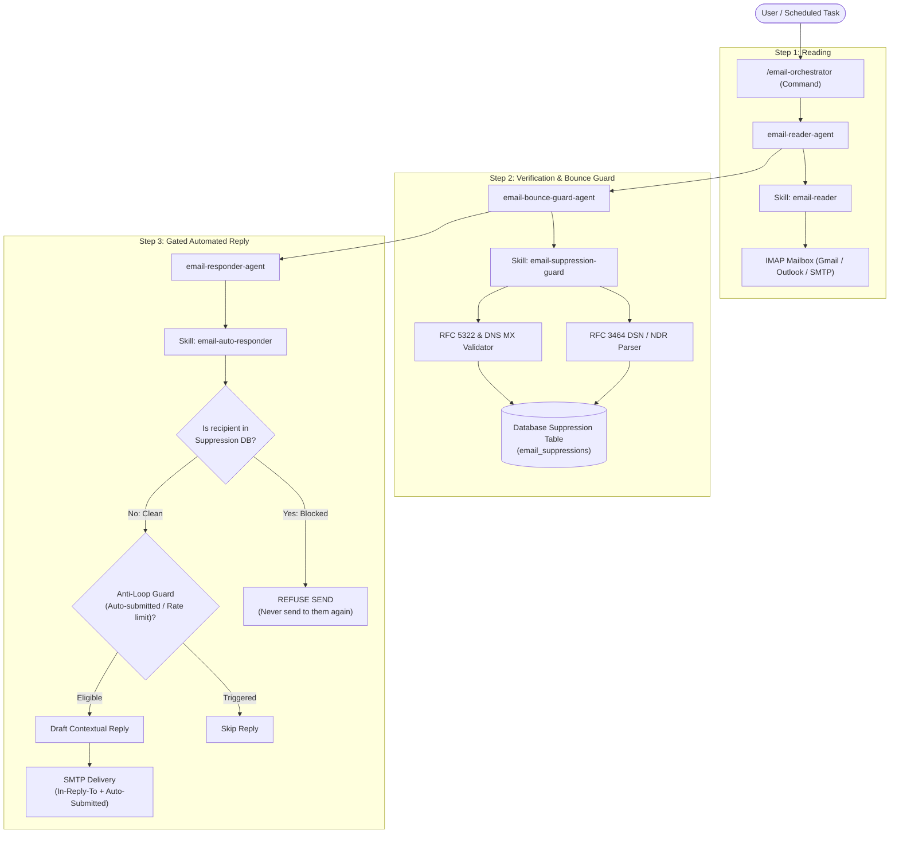
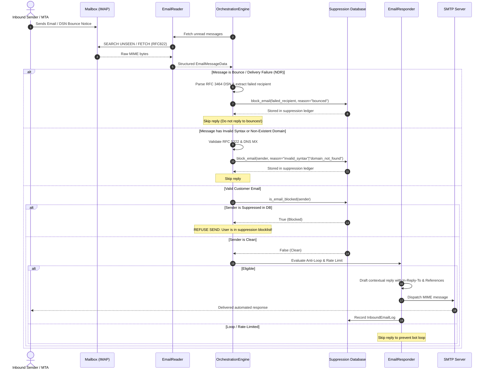

# Email Automation & Suppression Guard Workflow

Architecture and implementation guide for the automated email inbox reader, contextual auto-responder, and database suppression blocklist system.

Built following the **Command → Agent → Skill** orchestration pattern demonstrated in [claude-code-best-practice](https://github.com/shanraisshan/claude-code-best-practice).

---

## 1. System Overview

The system provides an automated pipeline for:
1. **Connecting to Email**: Connecting securely via IMAP (supports Google Workspace / Gmail App Passwords, Microsoft 365, and standard SMTP/IMAP servers).
2. **Reading Inbound Emails**: Fetching unread emails, parsing MIME multipart structures, decoding UTF-8/quoted-printable headers, and extracting conversation thread references (`Message-ID`, `In-Reply-To`, `References`).
3. **Automated Replies**: Evaluating anti-loop safety policies (RFC 3834), drafting contextual, professional replies, and delivering threaded responses over SMTP.
4. **Database Suppression Blocklist (Fail-Closed Gate)**:
   - Detecting "wrong" or invalid email addresses (RFC 5322 syntax errors, non-existent domains, missing DNS MX records).
   - Parsing RFC 3464 Delivery Status Notifications (DSN) / Non-Delivery Reports (NDR) from mailer-daemons and extracting the failed recipient.
   - Recording bad/bounced addresses into the database suppression table.
   - Gating every outgoing send: checking the database blocklist before sending any email, so blocked recipients are never emailed again.

---

## 2. Component Architecture (Claude Code Best Practice)

| Component | Type | Path | Role |
|-----------|------|------|------|
| **Command** | Entry Point | [`.claude/commands/email-orchestrator.md`](.claude/commands/email-orchestrator.md) | User interaction, orchestrates subagents and skills |
| **Agent** | Subagent | [`.claude/agents/email-reader-agent.md`](.claude/agents/email-reader-agent.md) | Connects to mailboxes, polls unread messages, extracts threads |
| **Agent** | Subagent | [`.claude/agents/email-bounce-guard-agent.md`](.claude/agents/email-bounce-guard-agent.md) | Parses bounce notices, validates addresses, blocks wrong emails in DB |
| **Agent** | Subagent | [`.claude/agents/email-responder-agent.md`](.claude/agents/email-responder-agent.md) | Evaluates anti-loop policies, drafts replies, dispatches over SMTP |
| **Agent** | Subagent | [`.claude/agents/whatsapp-personal-agent.md`](.claude/agents/whatsapp-personal-agent.md) | Pairs personal WhatsApp via QR code, automates contextual AI replies |
| **Command** | Entry Point | [`.claude/commands/whatsapp-personal.md`](.claude/commands/whatsapp-personal.md) | Slash command to pair personal WhatsApp and manage AI responder |
| **Skill** | Domain Skill | [`.agents/skills/whatsapp-personal/SKILL.md`](.agents/skills/whatsapp-personal/SKILL.md) | Multi-Device WhatsApp Web protocol, QR generation, session persistence |
| **Skill** | Domain Skill | [`.agents/skills/email-reader/SKILL.md`](.agents/skills/email-reader/SKILL.md) | Instructions and tools for IMAP polling and MIME parsing |
| **Skill** | Domain Skill | [`.agents/skills/email-suppression-guard/SKILL.md`](.agents/skills/email-suppression-guard/SKILL.md) | Verification tools, RFC 3464 DSN parser, suppression database management |
| **Skill** | Domain Skill | [`.agents/skills/email-auto-responder/SKILL.md`](.agents/skills/email-auto-responder/SKILL.md) | Anti-loop contracts, RFC 3834 headers, SMTP threaded dispatch |
| **Backend Engine** | Python Package | [`tools/email_automation/`](tools/email_automation/) | Production-grade Python engine with CLI and automated tests |

---

## 3. Workflow Diagrams

### Orchestration Flow (Command → Agent → Skill)



### Inbound Email Processing Sequence



---

## 4. Database Schema & Privacy Envelope

The suppression blocklist is stored in the `email_suppressions` table (and integrates with OpsGrids `notification.suppressions` and `notification.consent_events`):

```sql
CREATE TABLE email_suppressions (
    id VARCHAR(36) PRIMARY KEY,
    organization_id VARCHAR(36) NOT NULL,
    email VARCHAR(255) NOT NULL,
    email_masked VARCHAR(255) NOT NULL,
    email_index VARCHAR(64) NOT NULL,
    reason VARCHAR(32) NOT NULL,
    diagnostic_detail TEXT NOT NULL DEFAULT '',
    created_at TIMESTAMP WITH TIME ZONE NOT NULL DEFAULT CURRENT_TIMESTAMP,
    CONSTRAINT uq_email_suppression_org_index UNIQUE (organization_id, email_index)
);
```

### Privacy & Tenancy Guarantees
- **Multi-Tenancy**: Every row carries `organization_id`. Lookups are strictly scoped by tenant.
- **Blind Index & Masking**: Emails are indexed using deterministic HMAC-SHA256 (`email_index`) and masked (`b•••@domain.com`) using OpsGrids' `platform_core.pii` envelope when available.
- **Fail-Closed Gate**: If an email exists in this table, all future automated sends and campaigns refuse to deliver to that address.

---

## 5. Environment Configuration

Add the following to your `.env` or service configuration:

```env
# IMAP Inbox Connection
EMAIL_IMAP_HOST=imap.gmail.com
EMAIL_IMAP_PORT=993
EMAIL_IMAP_USE_SSL=true

# SMTP Outbound Delivery
EMAIL_SMTP_HOST=smtp.gmail.com
EMAIL_SMTP_PORT=587
EMAIL_SMTP_USE_TLS=true
EMAIL_SMTP_USE_SSL=false

# Credentials
EMAIL_USERNAME=support@yourdomain.com
EMAIL_PASSWORD=your-app-specific-password

# Identity
EMAIL_FROM_NAME="Customer Support"
EMAIL_FROM_EMAIL=support@yourdomain.com

# Multi-Tenancy & Database
EMAIL_ORGANIZATION_ID=00000000-0000-0000-0000-000000000000
EMAIL_DATABASE_URL=sqlite:///email_automation.db

# Multi-AI Configuration (ChatGPT & Google Gemini)
OPENAI_API_KEY=sk-...
OPENAI_MODEL=gpt-4o-mini
GEMINI_API_KEY=AIzaSy...
GEMINI_MODEL=gemini-1.5-flash
AI_PROVIDER=auto

# Behavior & Safety
EMAIL_DRY_RUN=false
EMAIL_AUTO_REPLY_ENABLED=true
EMAIL_RATE_LIMIT_HOURS=24
```

> [!TIP]
> For Gmail / Google Workspace, generate a 16-character **App Password** via Google Account Security → 2-Step Verification → App passwords.

---

## 6. CLI Command Reference

The command-line tool `tools.email_automation.cli` provides complete control:

### Run Full Email Processing Cycle
```bash
# Live mode (reads inbox, replies, blocks bad emails)
uv run python -m tools.email_automation.cli run --limit 20

# Dry-run test mode (stages replies without sending real SMTP emails)
uv run python -m tools.email_automation.cli run --dry-run --limit 20
```

### Read & Inspect Unread Inbox Messages
```bash
uv run python -m tools.email_automation.cli read --limit 10
```

### Verify an Email (Syntax & DNS MX Records)
```bash
uv run python -m tools.email_automation.cli verify "alex@opsgrids.com"
uv run python -m tools.email_automation.cli verify "fake..user@nonexistent-domain-xyz987.com"
```

### Manually Block Wrong / Bounced Email in Database
```bash
uv run python -m tools.email_automation.cli block "baduser@nowhere.com" --reason bounced --detail "550 5.1.1 User unknown"
```

### Check if Email is Blocked in Database
```bash
uv run python -m tools.email_automation.cli check "baduser@nowhere.com"
```

### List All Blocked / Suppressed Emails
```bash
uv run python -m tools.email_automation.cli list-blocked --limit 50
```

### Unblock an Email
```bash
# For manual blocks:
uv run python -m tools.email_automation.cli unblock "user@domain.com"

# Force unblock a bounced address:
uv run python -m tools.email_automation.cli unblock "bounced@domain.com" --force
```

---

## 7. Personal WhatsApp Connection (QR Code Pairing)

No Meta Business Account or Facebook developer approval required. Link your personal WhatsApp account in seconds:

### 1. Check Personal WhatsApp Link Status
```bash
uv run python -m tools.whatsapp_personal.cli status
```

### 2. Display Pairing QR Code in Terminal
```bash
uv run python -m tools.whatsapp_personal.cli connect
```
Open WhatsApp on your phone:
**Settings → Linked Devices → Link a Device → Scan QR Code**.
Once scanned, session keys are stored locally in `tools/whatsapp_personal/auth_info_baileys/`.

### 3. Simulate AI Automated Reply
```bash
uv run python -m tools.whatsapp_personal.cli simulate 919876543210 "Hi, does OpsGrids integrate inventory with invoicing?"
```

---

## 8. Verification Test Suite

A complete automated test suite is available under `tests/email_automation/`:

```bash
PYTHONPATH=. uv run pytest tests/email_automation/ -v
```

Tests include:
- `test_validator.py`: RFC 5322 syntax validation, disposable domain checks, DNS MX lookups
- `test_bounce_parser.py`: RFC 3464 multipart DSN parsing, 5xx status codes, failed recipient extraction
- `test_reader.py`: MIME structure parsing, charset decoding, thread headers, auto-submitted detection
- `test_suppression_service.py`: Database storage, blind index generation, masking, cross-tenant isolation, unblocking policies
- `test_orchestrator.py`: End-to-end integration: bounce handling, syntax blocking, suppression gate enforcement, and automated reply dispatch with rate-limiting.
